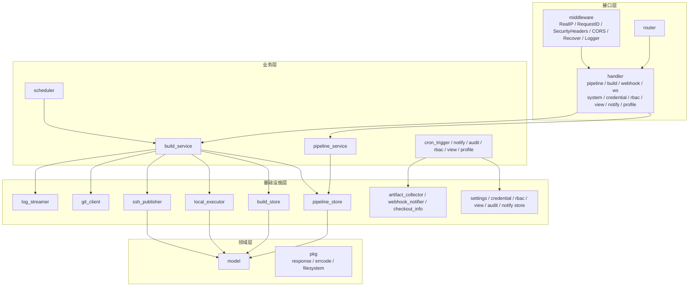
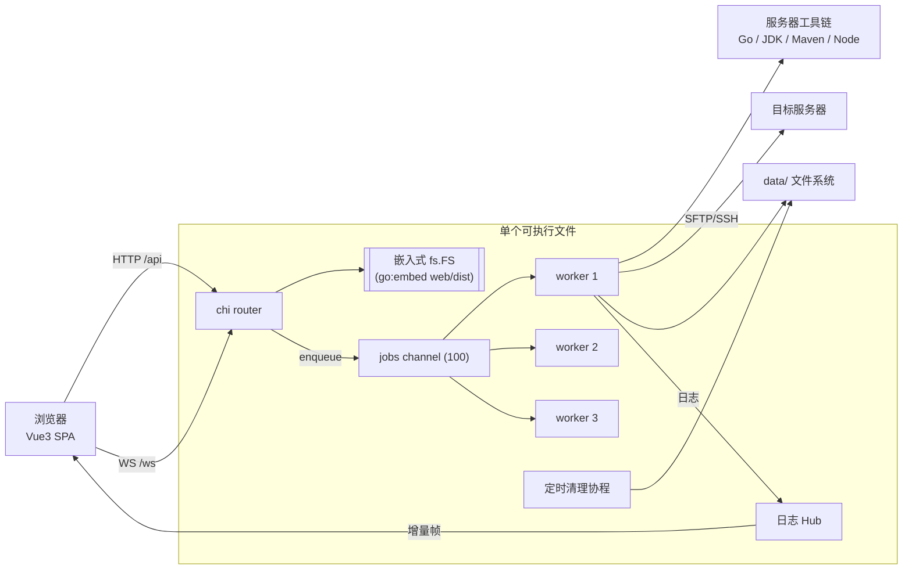
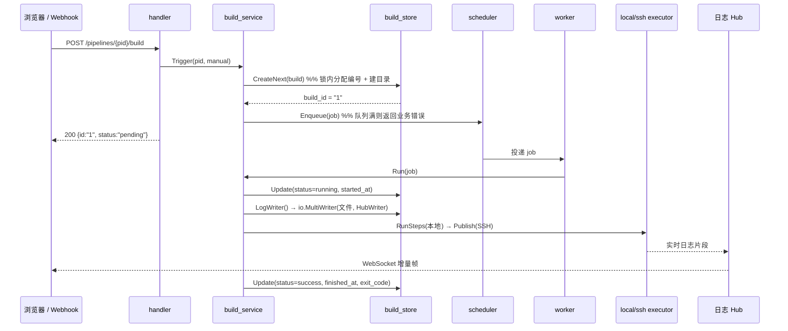
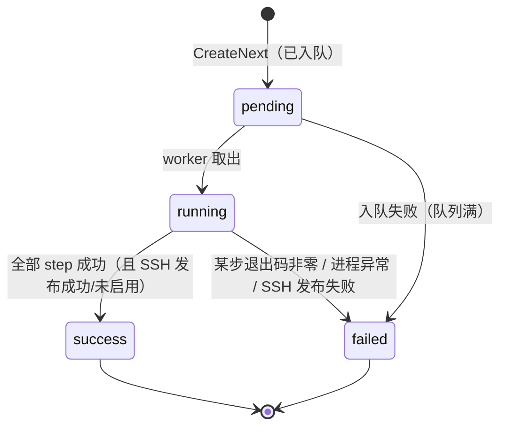
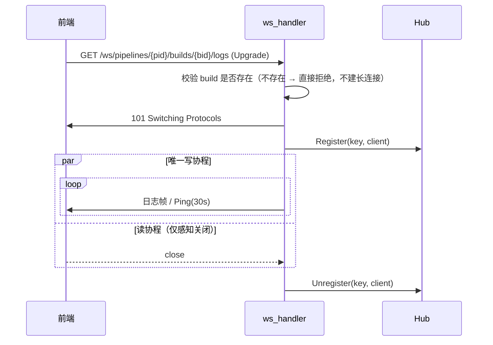
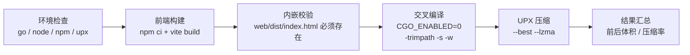

# 设计文档 · 轻量 CI/CD 平台

> 配套文档：[README.md](./README.md)（安装、构建、API）。
> 本文说明**为什么这么设计**，以及各子系统的关键机制与权衡。

---

## 1. 文档目的与范围

本文覆盖以下子系统的设计决策：

- 分层架构与依赖方向约束
- 文件系统存储（替代数据库）的正确性保障
- 构建执行引擎（状态机、并发模型、本地步骤执行）
- 日志子系统（双写、广播、背压、WebSocket 生命周期）
- SSH 发布子系统
- 定时构建（cron）、构建取消、构建与产物删除
- 构建结果通知（项目 × 人员/群/事件、值班轮值、升级、抑制、分支路由、消息模板、投递记录）
- 操作审计、多用户与角色授权、个人资料与邮箱验证
- 前端架构（状态、轮询、重连）
- 前端内嵌与单文件交付
- 构建与发布流水线

不在范围内：多节点 agent、DAG 并行、插件系统、multibranch / pipeline-as-code（见 §15）。

---

## 2. 设计目标与约束

| 类别 | 内容 |
|---|---|
| 核心目标 | 还原 Jenkins 最核心的用户心智，而非复刻其插件生态与 Groovy 能力 |
| 硬性约束 1 | **禁止引入任何数据库**（SQLite / MySQL / PostgreSQL 均不可），存储只走文件系统 |
| 硬性约束 2 | 构建直接在服务器本地执行，语言版本由已安装工具与「全局工具配置」决定，**代码中禁止出现 `switch language` 分支** |
| 硬性约束 3 | 依赖单向：`handler → service → store / executor → model`，禁止反向 import |
| 硬性约束 4 | SSH 交互必须全部收敛在 `ssh_publisher.go`，service 层禁止拼 SSH 命令 |
| 硬性约束 5 | 发布形态为**单文件**：前端资源内嵌，部署只需一个可执行文件 |
| 优先原则 | 优先「可运行」而非「功能多」：宁可少一个边缘功能，不可留断裂链路 |

---

## 3. 总体架构

### 3.1 分层与依赖方向



**依赖方向铁律**（`service` 通过 interface 依赖下游，接口定义在消费方 `service` 包内）：

| 层 | 只允许做 | 明确禁止 |
|---|---|---|
| `handler` | 参数解析、调 service、统一响应 | 业务分支、直接操作文件系统 |
| `service` | 唯一业务编排（状态流转、调度入队、事务边界） | 直接读写文件、拼 shell/ssh 命令 |
| `store` | 只做文件读写并返回 model | 状态机判断、调用 executor |
| `executor` | 接收参数执行本地命令/SSH/Git，通过 `io.Writer` 流式输出 | 访问 store |
| `model` | 纯结构体与枚举常量 | 任何 IO |
| `main` | 只做装配与生命周期 | handler/service 内做全局初始化 |

**收益**：`executor` 不依赖 `store`、`service` 只依赖抽象，因此把本地执行器换成远程 agent、或把存储换成对象存储，都只影响单层。

### 3.2 运行时组件图



### 3.3 一次构建请求的流转



---

## 4. 技术选型与理由

| 维度 | 选择 | 理由 |
|---|---|---|
| 后端语言 | Go 1.24 | 单二进制交付、`io.Writer` 流式管道天然适合日志转发、并发模型简洁 |
| HTTP 框架 | chi v5 | 标准库 `net/http` 兼容、路由树轻量、不引入额外抽象 |
| 存储 | 文件系统 | 硬性约束；且 JSON + 文本对人类可读、可 `git` 化、零运维 |
| 本地执行 | `os/exec` | 每个步骤独立进程，精确拿到退出码；stdout/stderr 直接流式写入日志 |
| SSH | `x/crypto/ssh` | 相比 CLI 封装：可直接读 stdout/stderr 管道，实现实时流式回显 |
| 文件传输 | `pkg/sftp` | 相比 `scp` CLI：可编程建目录、可精确控制路径映射 |
| WebSocket | `gorilla/websocket` | 成熟稳定，社区验证充分 |
| Git | `go-git` | 免安装 git 依赖，纯 Go 实现便于交叉编译 |
| 前端 | Vue3 + TS + Vite | 组合式 API 与 TS 类型能一一对齐后端 json tag |
| 前端交付 | `go:embed` | 硬性约束 5：单文件交付，消除「静态资源找不到」整类故障 |

---

## 5. 存储子系统设计

### 5.1 布局

采用 **「目录名即 ID」** 的设计，对齐 `JENKINS_HOME/jobs/{jobname}/builds/{id}/`：

```
data/                                    # DATA_HOME
├── settings.json                        # 系统配置（含邮件 / Webhook / SSH 服务器 / 工具 / 保留策略）
├── rbac.json                            # 角色、授权与平台内用户（密码 bcrypt，联系方式 + 邮箱验证状态）
├── views.json                           # 视图（列表视图 / 我的视图）
├── audit.log                            # 操作审计（JSONL，16MB 轮转为 audit.log.1）
├── notify.log                           # 通知投递记录（JSONL，16MB 轮转为 notify.log.1）
├── credentials/{credential_id}.json     # 凭据（密钥不回传）
├── jobs/{pipeline_id}/
│   ├── config.json                      # Pipeline 定义（含 notify：人员/群/轮值/升级/抑制/路由/模板）
│   ├── next_build                       # 下一个构建编号（单调递增，删除构建后不回退）
│   └── builds/{build_id}/
│       ├── build.json                   # 构建元数据（含分支/提交人，供分支路由与通知）
│       ├── log.txt                      # 控制台输出（受 log_max_mb 截断保护）
│       ├── artifacts.json               # 产物清单（路径 / 大小 / SHA-256）
│       └── artifacts/                   # 每次构建独立保留的编译产物
└── workspace/{workspace_dir}/           # 工作区（按任务名复用，默认不清空）
```

删除粒度：删任务 → 整个 `jobs/{pipeline_id}/`；删单次构建 → 仅 `builds/{build_id}/`
（日志 + 产物一起消失，见 §6.9）。

**数据目录可迁移**：数据根目录默认 `./data`，可由引导配置 `ci-platform.json`（`-config` / `CI_CONFIG_FILE`）记录，
也可用 `-data-home` / `CI_DATA_HOME` 覆盖（优先级更高）。系统配置页可修改该目录并把
`jobs/`、`credentials/`、`settings.json` 复制到新位置，重启后生效；`workspace/` 为临时产物不迁移。

**为什么不用索引文件**：索引会引入「索引与实体不一致」的整类问题，需要修复工具与校验逻辑。
直接遍历目录（Pipeline 数量级为百、Build 数量级为千）开销可接受，换来的是**任何时刻只删目录即可自洽**。

### 5.2 数据结构

`config.json`（`model.Pipeline`）与 `build.json`（`model.Build`）即领域对象的直接序列化，
前端 `web/src/types/*.ts` 与之**逐字段对齐**（同一套 json tag），因此不存在 DTO 映射层。

### 5.3 原子写入

`pkg.WriteFileAtomic` 的步骤：

```
写入 <dir>/.tmp-* → f.Sync() → f.Close() → os.Rename(tmp, target)
```

- 同目录临时文件保证 `rename` 是同一文件系统内的原子操作。
- `Sync()` 保证数据落盘后再改名，避免掉电后出现「文件名正确但内容为空」。
- 读方永远只会看到旧版本或新版本，**不会读到半截 JSON**。
- Windows 上 `os.Rename` 使用 `MOVEFILE_REPLACE_EXISTING`，可覆盖已存在目标。

### 5.4 构建编号分配与并发

天真实现「`NextBuildID()` 返回 max+1」再 `Create()` 存在竞态：两个并发触发会拿到同一编号，
而编号即目录名，后写者会覆盖先写者。

因此 `BuildStore` 提供 **`CreateNext`**，在**同一把锁内**完成「扫描最大编号 → +1 → 建目录 → 写 build.json」：

```go
s.mu.Lock()
defer s.mu.Unlock()
id, _ := s.nextBuildIDLocked(pipelineID)   // 扫描 builds/ 取最大数字 +1
b.ID = id
pkg.EnsureDir(s.buildDir(...))
pkg.WriteJSONAtomic(..., b)
```

由于结果对外表现为「编号连续、单调递增、不重号」，语义与 Jenkins 的 `#1`、`#2` 一致。

**编号不会因删除而回退**：仅在目录里取最大值 +1 时，删除最新的 `#5` 会让下一次构建又变成 `#5`，
同一任务出现两个内容不同的 `#5`，历史、产物与通知都会对不上。因此每次分配编号都会把
`jobs/{pipeline_id}/next_build` 写成「下一个编号」，读取时取 `max(目录最大值, next_build-1) + 1`。
这与 Jenkins 的 `nextBuildNumber` 文件是同一思路（见 §6.9）。

### 5.5 一致性边界与故障恢复

| 场景 | 表现 | 恢复方式 |
|---|---|---|
| 进程在构建途中被杀 | `build.json` 停留在 `running` | 下次启动时 `BuildService.Recover` 将残留的 pending/running 标记为 failed |
| `config.json` 损坏（人工改动等） | `List` 跳过该目录，其余任务可正常列出 | 单目录故障不影响整体可用性 |
| 目录中残留临时文件 `.tmp-*` | 不影响读取 | 可安全删除 |
| 任务被删除 | `Delete` 递归删整个 `data/jobs/{id}/` | 无残留 |

**路径安全**：所有对外的 `id` 进入 store 前都会经过 `sanitizeID`，拒绝空值、`/\:*?"<>|` 与 `..`，避免路径穿越逃出 `data/jobs`。

---

## 6. 构建执行引擎

### 6.1 状态机



### 6.2 执行时序（`build_service.executeStages`）

```
1. 准备工作区 data/workspace/{workspace_dir}/（目录名默认取任务名；默认复用；delete_workspace_before_build=true 时先清空）
2. git_url 非空 → 已有 .git 则 fetch + hard reset，否则浅克隆（Depth=1, SingleBranch）
3. 在服务器工作区串行执行 steps（退出码非零 → 立即返回该退出码）
   - 每个步骤通过 shell 启动独立进程，工作目录为任务 workspace
   - 全局环境变量 + 「全局工具配置」中的工具主目录注入 env，并把主目录/bin 前置到 PATH
4. 仅当 artifacts.enabled == true → 按 glob 归档产物到 build/artifacts/ 并写 artifacts.json
5. 仅当 ssh_publish.enabled == true → SSH 发布（上传 + 远程命令）
6. 归一退出码：步骤失败 = 该步退出码；归档/SSH 失败 = 1；成功 = 0
```

**退出码语义**：`exit_code` 只在「构建步骤失败」时反映真实退出码，归档/SSH 阶段失败统一记 `1`，
入队失败记 `-1`。这样使用者能区分「代码编译失败」与「发布失败」。

### 6.3 并发模型

```
jobs chan Job (容量 100)  +  N 个 worker goroutine（默认 3，CI_WORKERS 可调）
```

- 队列满时 `Enqueue` **立即返回业务错误**（`code=40900`），不阻塞调用方，也不无限堆积。
- worker 数量即「同时运行的构建数」上限，天然形成资源闸门，避免同时编译把服务器压垮。
- worker 在 `ctx.Done()` 时退出；停机流程为：信号 → HTTP `Shutdown` → `Scheduler.Drain`
  等待运行中的构建（默认最长 30s，`-shutdown-timeout` 可调）→ 取消 worker 上下文 → `Wait` 退出，
  未取出的排队任务保持 pending，由下次启动的 `Recover` 标记为中断。
- **同一任务的构建串行执行**（不同任务并行）：避免并发写同一工作区；繁忙任务不会占满全部 worker。

### 6.4 步骤执行：逐步执行而非拼接脚本

若把 `steps` 拼成单个 shell 脚本，则无法区分是哪一步失败，中间步骤的退出码也会丢失。
因此每一步单独启动 `exec.CommandContext`，工作目录固定为任务 workspace：

| 收益 | 说明 |
|---|---|
| 精确退出码 | `cmd.Wait()` 返回每步独立退出码 |
| 实时输出 | stdout/stderr 直接写入 `io.Writer`，日志与 WebSocket 同步可见 |
| 明确边界 | 未被允许的失败会中止后续 `when=success` 步骤并打印 `step %q failed with exit code %d`（细节见 6.11） |
| 环境一致 | 每步继承同一份环境变量（全局变量 + 工具主目录 + PATH） |

构建被取消时的进程树处理（`local_executor.go`）：

- **不能用 `exec.CommandContext`**：它会在 ctx 取消时抢先杀掉 `cmd.exe` 本身，导致
  `taskkill /T` 找不到进程树，而孙进程（`sleep`/`npm`/`mvn`）仍持有管道写端，
  `cmd.Wait()` 永远阻塞，构建状态无法落盘。
- 因此手动 `Start` + `Wait`，ctx 取消/超时时用 `taskkill /T /F`（Windows）/
  `SIGKILL` 进程组（Unix）杀整树，彻底释放管道与文件句柄。
- 取消分支在 `ExitError` 分支之前判断：被强杀的进程返回 ExitError，若不先判 ctx
  会把退出码 1 当成构建失败；先判 ctx 则正确落入 `aborted`。
- 用户主动取消（`POST .../cancel`）状态落 `aborted`（`ExitCode = -1`），与
  「代码问题导致的 `failed`」区分开，对齐 Jenkins 的 aborted 语义。

### 6.5 定时构建（Cron）

- 任务配置 `cron_spec`：5 字段 cron 规格（分 时 日 月 周），对齐 Jenkins Build periodically。
- 支持 `H` 散列均衡（Jenkins 语义）：`H/15 * * * *` 每小时 4 次，偏移按任务名 FNV-1a 散列
  固定（重启后不变），避免大量任务同时配置时同一瞬间集中触发；也支持 `H(a-b)` 范围散列。
- 标准语法：`*`、`*/n`、`a-b`、`a-b/n`、`a,b`；dom 与 dow 都受限时取并集（Vixie cron 语义）。
- 保存前校验语法（`NextCron` 同时验证一年内存在命中时刻，如 2 月 30 日会被拒绝）。
- `CronTrigger`（`cron_trigger.go`）每 30s 扫描任务列表，到期即以 `timer` 触发方式入队；
  计划时刻仅存内存（重启后重算，最多延迟一个扫描周期）；静默模式下顺延不触发。
- 触发记录在构建历史中显示为「定时触发」（`trigger_type=timer`）。

### 6.6 删除任务时清理工作区

`PipelineService.Delete` 在删除 `data/jobs/{id}` 之前先删除工作区目录
`data/workspace/{workspace_dir}`（递归），避免同名任务重建时残留旧构建产物；
工作区删除失败时返回错误并中止删除（不留下孤儿目录）。

### 6.7 构建产物归档

- 每个 build 目录下独立保存 `artifacts/` 与 `artifacts.json`，**下次构建不会覆盖历史产物**，用于回滚。
- 配置在任务「构建后操作 → 归档构建产物」：`artifacts.enabled` + `artifacts.files`（相对工作区 glob）。
- 归档时机：**构建步骤成功之后、SSH 发布之前**。SSH 发布失败时产物仍已落盘，构建页可下载。
- 旧任务一次性迁移：从 `go build -o <file>` / `jar cf <file>` 推断输出并自动启用（marker `.artifact-config-v1`）；其余保持关闭。
- 至少匹配一个文件，否则构建失败并提示，避免“构建成功但没有任何可回滚产物”。
- **规模保护**：`Settings.ArtifactMaxTotalMB` / `ArtifactMaxFiles`（默认 4096MB / 10000 文件）
  在归档前与复制后双重校验，超限时归档目录被清理并使构建失败，不会写满磁盘。
- 不跟随符号链接；只复制普通文件，保留可执行位，并计算 SHA-256 写入清单。
- 产物随「丢弃旧的构建」策略一起删除（`DeleteBuild` 递归删除 build 目录）；想保留全部历史构建就把保留数量/天数设为 0。
- **一键重新发布**：`BuildService.Republish` 读取成功构建的 `artifacts/`（由 `ArtifactReader.Manifest` 校验），
  `SshPublisher.PublishArtifacts` 只上传不编译；要求任务/请求提供 `server_id`，远程目录为空或 `/` 直接拒绝。
- 读取侧只允许下载 `artifacts.json` 清单中的相对路径，拒绝 `../`、绝对路径与符号链接。

### 6.8 构建产物清理

- **构建后清理**：每次构建结束后应用保留策略（任务级配置优先，否则回落全局
  Build Discarders：`build_retention_max_per_job` / `build_retention_max_age_days`），
  删除超量的旧构建目录（含日志与产物）。
- **定期扫描**（`PruneAll`）：每小时对全部任务应用全局保留策略，
  补上「不活跃任务永不清理」的缺口（构建后清理只覆盖有新构建的任务）。
- **日志大小上限**（`log_max_mb`，默认 100）：单次构建日志超过上限后截断并标注
  （`LimitedWriter`），不中断构建、不影响构建结果；在线 WebSocket 实时日志不限制。
- **产物限制**：`artifact_max_total_mb` / `artifact_max_files` 超限时构建失败（防假绿）。
- 启动时清理孤儿工作区（TTL 之外），删除任务时连工作区一并删除。

### 6.9 手动删除单次构建

- **接口**：`DELETE /api/pipelines/{pid}/builds/{bid}`，权限 `job.delete`（与删除任务同权限点）。
- **删除范围**：整个构建目录 `data/jobs/{pid}/builds/{bid}`——`build.json`、`log.txt`、
  `artifacts/`（清单与产物文件）一次性移除；任务目录与其它构建保持不变。
- **拒绝运行中/排队中的构建**（40900）：日志与产物仍在写入，删目录会让状态永远停在
  running 并留下半截日志。正确顺序是「停止构建 →（aborted）→ 删除」。
- **幂等**：目标不存在（重复点击 / 并发删除）返回成功，避免前端重试看到无意义的 40400。
- **编号单调**：编号原本由「扫描构建目录取最大 +1」得出，删掉最新构建后会复用同一个编号，
  导致同一任务出现两个内容不同的 `#5`。现在每次分配编号都会把 `next_build`
  （`data/jobs/{pid}/next_build`）写成「下一个编号」，删除目录后编号仍不回退（与 Jenkins
  `nextBuildNumber` 一致）。保留策略删旧构建不受影响（最大值仍在）。
- **UI**：任务页构建历史每行「删除」（仅非运行态 + 有 `job.delete`）、构建日志页「删除构建」、
  全局构建历史行内「删除」，均二次确认并提示不可恢复。

### 6.10 工作区生命周期

- 路径：`data/workspace/{workspace_dir}`，目录名默认取任务名（非法字符替换、重名追加 `-{id}`），重命名任务时同步移动；默认**不清空**，保留上次产物与依赖缓存。
- 仅当任务显式设置 `delete_workspace_before_build=true` 时构建前删除整个工作区（会重新 clone）。
- Git 更新：已有 `.git` 时只 fetch；远端无新提交且受跟踪文件干净则跳过 reset。
- go-git 的 checkout/reset 会删除未跟踪与 `.gitignore` 忽略的文件，因此更新前把它们临时移动到工作区外的备份目录，
  更新后再移回；这样 `node_modules` / `target` / `dist` / Go 产物等缓存不会被清掉。
- 清理协程跳过**正在执行或排队中**的任务工作区，避免误删。
- 「管理旧数据」页面只列出/删除**无对应任务**的孤儿工作区与孤儿任务目录，仍存在任务的工作区一律保留。
- 只要任务仍然存在，其工作区就不参与 TTL 清理；只清理已删除任务遗留的孤儿目录。
- 构建结束后由 scheduler `os.Chtimes` 刷新目录 mtime，作为清理计时基准。
- 孤儿目录按 `CI_CLEAN_INTERVAL_MINUTES` 周期扫描，删除 mtime 早于 `CI_WORKSPACE_TTL_MINUTES`（默认 1h）的目录。
- **为什么用 mtime 而不是「创建时间文件」**：少一个元数据文件，且构建期间的写入天然刷新 mtime；
  构建结束时显式 touch 一次，即可让「TTL 从构建结束算起」这一语义成立。

---

### 6.11 参数化构建

参数定义存 `config.json` 的 `params`，值在**触发时**解析并快照进 `build.json` 的 `params`。

```
POST /pipelines/{id}/build  {"params":{"VERSION":"1.2.3"}}
   → ResolveBuildParams(defs, in)  // 校验 + 归一 + 取默认值
   → Build{Params: resolved}       // 快照，之后改默认值不影响历史
   → 执行时 env["VERSION"] = v; env["CI_PARAM_VERSION"] = v
```

**为什么在触发时快照**：构建记录要能回答「这次用的哪个版本/环境」。若执行时才去读
`pipeline.params.default`，用户改了默认值后历史构建就无法复盘。

**为什么提供两个环境变量名**：`VERSION` 对齐 Jenkins（脚本里 `$VERSION` 最自然），
`CI_PARAM_VERSION` 是平台命名空间下的稳定别名——任务参数与「全局属性」重名时，
全局属性会覆盖前者，但后者仍保留本次参数值。

**为什么拒绝 `CI_` 前缀**：平台内置变量（`CI_BUILD_ID` 等）由服务端注入，
允许任务定义同名参数等于允许篡改审计信息。

**为什么 Webhook 只认已定义的查询键**：Webhook URL 常被拼上 `?token=...` 之类参数，
把未知键一律报错会让既有集成全部失效，因此只按定义挑值、其余忽略。

**校验放在 service**：参数名/类型/默认值/数量上限都是业务规则，handler 不做判断
（`normalizeParams` 在 `normalizeAndValidate` 中调用）。

### 6.12 步骤级执行控制

步骤字段：`timeout_sec` / `retry` / `retry_delay_sec` / `allow_failure` / `when`。
执行器用一个 `stepState` 记录失败情况，逐步骤决策：

```
for step in steps:
    if !shouldRun(step.when, state): log("skipped ..."); continue
    code = runWithRetry(step)            # 每次尝试独立 context + 进程树杀灭
    if code == 0: continue
    state.anyFailed = true
    if step.allow_failure: log("allow_failure"); continue
    state.fatalFailed = true; state.fatalCode = first code
    # 不 return：让 when=always/failure 的收尾步骤继续跑
```

**为什么致命失败后不立即 return**：清理临时文件、收集诊断信息、通知外部系统这类步骤
恰恰最需要在失败后执行。若直接 return，它们永远拿不到执行机会，而这正是用户配置
`when: always` 的意图。最终仍返回第一个致命失败的退出码，构建结果不受影响。

**超时为什么用 124**：与 GNU `timeout` 一致，脚本里可以用 `if [ $? -eq 124 ]` 区分
「超时」和「普通失败」；同时它仍是「失败」，自然参与 retry / allow_failure。

**为什么父 ctx 取消优先于超时**：用户点「停止构建」时必须落 `aborted`，
不能被步骤超时抢先判成 `failed`（`aborted` 与 `failed` 的语义区分见 6.4）。

**重试为什么有上限**：`retry<=5`、`timeout<=24h`、`retry_delay<=60s` 都在服务端硬校验。
没有上限时一个 `retry=1000` 的笔误会让单次构建卡几小时，而且日志里只表现为"一直在跑"。

**`when=failure` 与 `allow_failure` 互斥**：前者表示「只在有失败时执行」，
后者表示「失败也无所谓」，同时配置是自相矛盾的，保存时直接拒绝而不是猜用户意图。

---

## 7. 日志子系统

### 7.1 双写管道

```go
out := io.MultiWriter(
    logFileWriter,                                  // → data/jobs/{pid}/builds/{bid}/log.txt
                                                    //   归档/SSH 日志也写入同一份文件
    executor.NewHubWriter(hub, "pid/bid"),          // → WebSocket 订阅者
)
```

同一份 `out` 被注入本地执行器、产物归档器与 SSH 发布器，因此**构建/归档/SSH 日志天然合并到同一份 `log.txt`、
同一个 WebSocket 流**，前端无需区分来源，也不需要多路复用逻辑。

### 7.2 Hub 设计

```go
type Hub struct {
    mu   sync.RWMutex
    subs map[string]map[Subscriber]struct{}   // key = pipeline_id/build_id
}
```

关键实现要点：

1. **`Subscriber` 是接口而非 `*websocket.Conn`** —— 避免 `executor` 反向依赖 `handler` 层（依赖铁律）。
2. **广播前拷贝订阅者快照，出锁后再投递** —— 锁内只做 map 读取，绝不在持锁期间做网络 IO，
   否则一个慢客户端会阻塞整个 Hub。
3. key 下订阅者清空时回收 map 条目，避免长期运行下 map 无限增长。

### 7.3 背压策略：宁可丢帧，不可阻塞构建

构建日志的生产速度不受控（一个 `mvn` 可能瞬间打出上万行）。若采用「写入阻塞直到客户端消费」的策略，
慢客户端会反压到命令输出读取循环，进而**拖慢甚至卡死构建**。

因此定为：每个连接一个带缓冲的 `send chan []byte`，投递时使用非阻塞 `select ... default`，
**缓冲满则直接丢弃该帧**。理由：

- 日志是**可补偿**的：前端在重连时通过 `GET .../log` 重新拉取全文，丢帧不会造成用户可见的数据缺失。
- 构建是**不可重来**的（可能已产生副作用），绝不能被观测端拖累。

### 7.4 WebSocket 连接生命周期



- **单写协程**：`gorilla/websocket` 不允许并发写，因此每个连接只由 `writePump` 一个 goroutine 写，
  其他来源只往 `send` channel 投递。
- **`Enqueue` 必须拷贝数据**：上游 `stdcopy.StdCopy` 会复用其读缓冲，
  若直接入队会在下次读取时被覆写，导致日志错乱。
- **`close` 幂等**：用 `sync.Once` 保护，读协程与写协程同时退出不会 panic。

### 7.5 中间件与 WebSocket 的兼容

`middleware.Logger` 用 `statusRecorder` 包裹 `ResponseWriter` 以记录状态码与字节数，
这层包装**必须透传 `http.Hijacker` 与 `http.Flusher`**，否则 `Upgrade` 会失败（握手返回非 101）。
这是本项目实际踩到并修复的问题。

### 7.6 前端的重连与补帧

`useBuildLog.ts` 的策略：

| 关注点 | 策略 |
|---|---|
| 首屏 | 先 `GET .../log` 拉全文，**再**建 WebSocket 接收增量 |
| 断线重连 | 指数退避 `1s → 2s → 4s → 8s → 16s`，最多 5 次 |
| 补帧 | 每次重连前重新拉全文日志，覆盖断线期间的空洞（简单且绝对正确） |
| 结束判定 | 构建已结束时**不建** WebSocket；由 `usePolling` 轮询状态，一旦终态则停轮询、关连接、补拉最终日志 |
| 卸载 | `onUnmounted` 关闭连接、停止轮询 |

**为什么用轮询判断「构建结束」而不是靠服务端推事件**：服务端结束构建与关闭连接是两个独立关注点，
引入「结束事件帧」会让协议多一种消息类型。轮询 2s 一次的代价可忽略，换来协议极简。

---

### 7.7 构建结果通知（项目 × 人员 / 群 × 事件）

**痛点**：全局收件人只有一份，不同项目的告警会发给所有人（或配置了多个项目的团队互相干扰）。
因此通知必须**按项目挂人/挂群**。

**数据模型**：

- 用户（`data/rbac.json`）新增联系方式：`email`（邮件）、`wecom_id`（企微 userid，群 @ 用）、
  `phone`（钉钉 @ 手机号）、`email_verified`（邮箱验证状态）。管理员在「系统管理 → 用户管理」维护，
  用户也可在「个人资料」页自助维护并验证邮箱（见 §8.3）。
- 任务（`config.json`）新增 `notify`：`enabled`、`use_global`、`people[]`（用户名，发送时解析联系方式）、
  `emails[]`（外部邮箱）、`targets[]`（钉钉/企微/Slack 机器人 + 每目标独立事件）、`events`（任务级事件）。

**解析优先级**（`NotifyService.plan`）：

| 任务配置 | 行为 |
|---|---|
| `notify.enabled = true` | 只发给任务级人员/群；`use_global` 时再叠加全局默认（去重后合并）|
| `notify = nil / enabled=false` | 回落「系统配置 → 邮件/Webhook 通知」的全局默认（兼容旧行为）|
| 邮件未启用（SMTP 关闭）| 不发送邮件（避免反复失败），群通知照常 |

**事件语义**（区别于「一律发成功」的噪音）：

- `failure`：构建失败；`success`：普通成功；**`fixed`：上次失败/取消 → 本次成功**；`aborted`：人为取消。
- 订阅「成功」也收到「修复」；只订阅「修复」时普通成功不通知——避免每日绿构建刷屏。
- 群目标可单独订阅事件（如：前端群只看失败，值班群看全部）。

**@ 提醒**：失败/取消事件时，对群内相关人员 @（钉钉用手机号、企微用 `<@userid>`），
成功/修复不打扰。

**可观测性**：发送结果写入构建日志，如
`[notify] event=failure；邮件 2 人（a@x, b@x）；群 1 个（wecom#1）；失败 1 个（dingtalk: ...）`，
便于事后核对「通知了谁、是否成功」。

**密钥安全**：任务级群机器人 URL 中的 `access_token`/`key`/`secret` 等查询参数在 GET 时脱敏为 `***`
（结构可读）；保存时若检测到脱敏形态与旧值一致则回填真实值（`pkg.MaskTokenQuery` 文本替换，
不重新编码）；失败日志只打印渠道名。

**测试**：任务配置页「发送测试通知」→ `POST /api/pipelines/{pid}/notify/test`，
不受事件过滤，用于验证「项目 → 人员/群」绑定是否正确。

**全局测试**：「系统配置 → Webhook 通知 → 发送测试通知」→ `POST /api/system/webhook/test`（管理员）。

#### 7.7.1 值班轮值、升级、抑制与分支路由

四个运维能力都挂在任务级 `notify` 上（全局默认不启用，避免影响既有部署）：

| 能力 | 字段 | 行为 |
|---|---|---|
| 值班轮值 on-call | `on_call{enabled, rotation[], start_date, period_days}` | 失败/取消时把「当周值班人」加入收件人并 @ 他；值经由「日期差 / 周期」取模算出（无隐藏状态，重启一致）；未填起点用固定锚点 2024-01-01，而不是「今天」（否则永远停在第一个人）|
| 升级 escalation | `escalation{enabled, after, people[], emails[], targets[]}` | 连续失败次数 ≥ `after`（默认 3，最小 2）时**追加**上级人员/群；**升级优先于抑制**——已经连败 N 次还静默就失去升级意义 |
| 抑制 suppression | `suppress_window_min`（0=关闭，最小 2）| 同一任务窗口内的连续失败只发首条，后续合并为「已连续失败 N 次」；抑制期不静默到死：达到升级阈值仍会升级。1 分钟被拒绝（几乎永久静默）|
| 分支路由 routes | `routes[]{match, people[], emails[], targets[], committer, on_call}` | 构建分支命中 glob 时叠加人员/群；`committer=true` 追加 git author 邮箱（feature/* 只通知提交者）；`*` 不跨 `/`，`**` 跨目录；空 `match`=所有分支。非 Git 任务显式写了 `match` 的路由不生效 |

**连续失败计数**（`failureStreak`）从构建历史倒序往前数，遇到非失败即停止；抑制窗口比较
「当前构建完成时间 − 上一次失败构建完成时间」，因此重启后判断结果不变（不依赖内存状态）。

**任务级消息模板** `notify.template`：支持 `{{job}} {{build}} {{event}} {{status}} {{branch}} {{commit}}
{{author}} {{duration}} {{url}} {{oncall}} {{streak}} {{message}}`；未知占位符原样保留（便于发现拼写错误），
邮件与群消息共用同一模板，**@ 提醒始终追加在末尾**（自定义模板不能吞掉「该 @ 谁」）。

**分支信息从哪来**：签出成功后由 `executor.ReadCheckoutInfo` 直接读 `.git`（go-git，不依赖 PATH），
把实际分支、短 SHA、提交人姓名/邮箱写进 `build.json`；读取失败不阻塞构建（退化为无分支信息）。

**密钥安全（升级群/路由群）**：`sanitizePipeline` 对基础目标、升级目标、路由目标统一脱敏；
保存时 `mergeNotifyURLs` 按「渠道 + 脱敏形态」索引一次性回填三处真实 URL。
注意脱敏时要**整体拷贝** `notify` 结构体，避免把 `***` 反写进内存里正在用于发送的配置。

#### 7.7.2 通知历史（谁漏收了告警）

- **落盘**：`data/notify.log`（JSONL，16MB 轮转），**按收件人/群粒度**一条记录：
  `{id, time, pipeline_id/name, build_id, event, channel, recipient, status, error, streak, escalated, on_call, branch}`。
  只有按收件人拆开，才能回答「这条告警谁没收到」；按构建聚合只能回答「发过没」。
- **状态**：`sent` / `failed`（带错误原因：SMTP 拒绝、机器人 token 失效）/ `suppressed`（命中抑制窗口，
  附带「连续失败 N 次，10 分钟抑制窗口内已合并」，解释「为什么没收到第二条」）。
- **ID**：单调递增，启动时从文件尾部恢复（与审计日志同一策略）。
- **查询**：`GET /api/system/notify?limit=&pipeline=&recipient=&status=`（`system.read`），
  过滤在服务层完成（先多取后截断，避免为组合加索引）。
- **UI**：「系统管理 → 通知记录」，可按任务、收件人、状态过滤，直接筛出「某人没收到」。

## 8. 审计、用户与个人资料

### 8.1 操作审计日志

- **记录点**：审计中间件（`middleware/audit.go`）拦截全部变更类 API（POST/PUT/DELETE），
  记录谁（用户）、何时、做了什么（动作+目标路径）、结果（业务码）、来源 IP；
  查询类请求不记录（量大且无审计价值）。
- **登录接口单独挂载**（在 Auth 之外）：成功后用户名从响应体解析；
  密码等请求体绝不落盘。
- **存储**：`data/audit.log` JSONL 追加写（每行一条 JSON，带文件锁+fsync）；
  追加型数据用 JSONL 比原子重写全文件更合适，断电最多丢最后一行。
- **查询**：`GET /api/system/audit?limit=300`（管理员），`Tail` 从文件尾部倒序读取；
  损坏行跳过。ID 单调递增，重启后从文件恢复最大值。
- **UI**：「系统管理 → 操作日志」（时间/用户/动作/目标/结果/IP）。

### 8.2 多用户管理

- **用户 CRUD**：`POST /api/security/users`（创建，bcrypt）、`POST /users/delete`、
  `PUT /users/password`（管理员重置，同时撤销全部登录会话）；接口返回时清空 hash。
- **登录回退**：管理员凭据不匹配后回退校验平台内用户（`VerifyLogin`）。
- **邮箱必填**：创建用户、管理员改联系方式、用户自助改资料都要求邮箱非空且形如 `a@b.c`
  （单一 `@`、域名至少两段）。原因很直接：构建通知按人员解析邮箱，允许留空等于允许
  「任务里选了人却永远收不到邮件」这种静默故障。旧数据可能没有邮箱：启动时
  `UsersWithoutEmail` 打 WARN，用户管理页顶部列出待补全名单，通知计划里也会带上
  `警告：人员 X 未配置邮箱`（写入构建日志），补全后警告自动消失。
- **账号管理**：独立页面「系统管理 → 用户管理」（对齐 Jenkins *Manage Users*），
  数据源 `GET /api/security/users`（内置管理员 + 平台用户 + 联系方式 + 角色摘要，
  密码哈希不出服务层）。新建/删除/重置密码/联系方式都在这里，
  内置管理员（系统配置里的登录用户）标记 `builtin` 且只读，避免把自己锁在门外。
- **授权**：角色/授权矩阵在「系统管理 → 管理角色 / 分配角色」两页维护（全局角色 + 任务角色 Pattern）。
  两页职责分离：用户管理 = 「谁是账号」，Assign Roles = 「账号能做什么」；
  账号不再兼作授权入口，授权页只保留勾选与「去用户管理」入口。

### 8.3 个人资料与邮箱验证（用户自助）

- **接口**：`GET /api/profile`、`PUT /api/profile/contact`、`POST /api/profile/email/verify`、
  `POST /api/profile/email/confirm`；挂在 Auth 之后但**不要求 Administer**（任何登录用户都能改自己的联系方式）。
- **身份来源**：一律取登录态（`pkg.UserFromContext`），请求体不接受用户名，避免越权改他人资料。
- **内置管理员只读**：其账号来自系统配置、不在 `rbac.json` 中，返回 `builtin=true`；改联系方式返回 40300，
  引导到「系统配置」。
- **邮箱必填**：`PUT /api/profile/contact` 与创建用户同一规则（空邮箱返回 40000），
  因为这是告警邮件的唯一投递地址。
- **邮箱验证**：6 位数字码（crypto/rand），10 分钟有效，同一用户 60 秒内不可重复发码（42900）；
  验证码只对发码时的邮箱有效，**改邮箱会立即清除 `email_verified`**；SMTP 未启用时直接返回可读错误，
  不发无效请求。发送失败会清掉本次验证码与限流额度（否则用户拿不到码还被限流）。
- **为什么重要**：通知可靠性依赖邮箱正确，管理员逐个代填成本高且容易过期；自助 + 验证能把
  「邮箱写错」从「靠猜」变成「用户自己确认过」。

## 9. SSH 发布子系统

对齐 Jenkins **Publish Over SSH** 的核心行为：上传指定文件到远程目录，可选在远程执行命令。

**配置分层**：

- **全局 SSH 服务器**：`settings.SshServers`（`data/settings.json`），集中维护 host/port/user/认证/私钥/密码/
  `known_hosts_path`/默认远程目录；接口返回时密码清空并标记 `has_password`，与 auth/SMTP 密码一致。
- **视图（Views，给任务归类）**：`data/views.json` 存视图；列表视图 = 显式任务 + 任务名正则
  （忽略大小写），我的视图 = 当前用户有 `job.read` 权限的任务；视图内任务统一按权限过滤，
  未授权任务一律隐藏；展示列与 Widgets 随视图持久化。
- **RBAC（管理角色 / 分配角色）**：`data/rbac.json` 存角色/授权/用户；全局权限由路由中间件
  `RequirePerm` 校验，任务级权限由 `RequireJobPerm` 按任务名与角色 Pattern 匹配（忽略大小写、完全匹配，
  对齐 Jenkins Role Strategy）；Administer 隐含全部权限，系统管理员用户不可被 RBAC 降权（防锁死）；
  `/auth/me` 返回用户有效权限，前端据此隐藏入口。权限不足返回 `code=40300`。
- **任务级**：`ssh_publishes[]`（多目标，每项含 `name` + `server_id` + `source_files` / `remove_prefix` /
  `exec_command` / 可选远程目录覆盖）；上限 10 个，名称唯一（自动补「发布 N」与 `(2)` 后缀）。
  构建时 `BuildService.resolveSshConfig` 逐目标合并为完整配置；旧版单目标 `ssh_publish`
  与内联 host/username 配置在保存时自动迁移为列表里的「默认发布」。

**多目标为什么「失败不阻断其余目标」**：发布到生产 + 备份两台机器时，生产失败不应该让备份也不发；
用户需要的是「尽可能完成所有目标，然后告诉我哪些失败了」，日志里每个目标一行
`[ssh] target "名称" ...`，最终错误汇总为 `ssh publish failed (N/M targets): ...`。

```
1. dial  → 密钥(读 private_key_path，支持 `~/`) 或 密码认证；配置 `known_hosts_path` 时用
   `knownhosts.New` 校验主机密钥，未知主机拒绝连接；未配置时回退 `InsecureIgnoreHostKey` 并输出 WARN
2. upload → glob 展开 source_files → 计算相对路径 → 剥离 remove_prefix → SFTP MkdirAll + Create
3. exec   → exec_command 非空则开 session，stdout/stderr 两个 goroutine 合流入 out
```

要点：

- **`enabled=false` 时 `Publish` 立即返回 `nil`**，不发起任何连接（硬性约束，已在单测中断言）。
- **路径映射**：`applyRemovePrefix` 对 `target/` 与 `target` 两种写法都做兼容，
  并保证剥离后为空时回退原路径（避免上传到基础目录根导致文件名丢失）。
- **目录过滤**：`matchFiles` 只保留普通文件，遇到匹配到目录时跳过，避免 `Create` 失败。
- **transfer 选项**：`clean_remote` 在上传前 `RemoveAll(remote_base_dir)`（对齐 Jenkins cleanRemote，
  校验阶段强制要求非空且非 `/`）；`flatten` 只保留 `path.Base(rel)`；`exec_timeout_sec` 用独立
  context 约束远程命令（超时关闭会话），与构建级超时互不干扰。
- **安全**：`known_hosts_path` 配置后可抵御中间人攻击；未配置时保持兼容并输出 WARN，
  生产环境建议在「系统配置 → SSH 服务器」中填写。

---

## 10. 从 Jenkins 导入任务

Jenkins 没有「迁移任务」的标准 REST API：`config.xml` + `createItem` 只能搬配置，
带构建历史只能停服拷 `jobs/{name}` 目录。本平台把它做成服务端内建的一键导入：

```
POST /api/system/import/jenkins?name=order&mode=create&dry_run=false
Content-Type: application/xml
<project>…config.xml…</project>
        │
        ├─ importer.FromJenkinsXML(xml, servers)  // XML → model.Pipeline + warnings
        ├─ PipelineService.Validate(p)            // 复用 Create 的校验（cron/参数/SSH）
        └─ Create / Update / skip                 // 重名策略
```

### 10.1 为什么「翻译语义」而不是「复制结构」

- Jenkins 的 XML 是「插件类名 + 字段名」的序列化结果，标签名随插件版本变化
  （`hudson.tasks.Shell`、`jenkins.plugins.publish__over__ssh.BapSshPublisher`…），
  用固定 struct tag 解析会被插件差异击穿。因此 importer 先把 XML 解析成**通用节点树**，
  再按「类名后缀」匹配（`node.matches("shell")`），对插件版本不敏感。
- 我们的 `config.json` 是执行器的真实输入，前端与校验都基于它。若照搬 Jenkins 结构，
  等于让执行器去理解插件模型，复杂度会扩散到所有层，而迁移仍然需要转换层——
  只是把转换从「一个入口」挪到了「处处」。
- 结论：**入口做翻译，存储保持自己的语义模型**。原始 `config.xml` 另存为
  `data/jobs/{id}/jenkins-config.xml`，需要时可重导或人工核对。

### 10.2 告警分级（迁移的核心风险控制）

迁移最容易出的事故不是「报错」，而是「导进去了但配置悄悄丢了」。因此 importer 返回
`warnings[]`，分三级：

| 级别 | 含义 | 例子 |
|---|---|---|
| `error` | 不处理就用不了 | 密码型参数（平台不脱敏）、SSH 服务器不存在（目标已停用）、无法识别的 builder（占位步骤） |
| `warn` | 已降级，需要知晓 | 多分支只取第一个、凭据无法迁移、Disable 状态无对应字段、构建包装器被忽略 |
| `info` | 语义不同但无需操作 | Timestamper 已内置、SCM 轮询改用 Webhook、Maven 安装名改用全局工具配置 |

`dry_run=true` 先返回 `pipeline + warnings` 但不落盘：用户看完告警再决定是否导入，
避免「先建出错的任务，再删掉重来」。

### 10.3 关键映射决策

| 决策 | 理由 |
|---|---|
| Publish Over SSH 按 **服务器名/host** 自动匹配 `server_id` | Jenkins 的 `configName` 就是服务器名；匹配不到时**保存为停用**而不是启用空主机——启用空主机等于下次构建必定失败 |
| 每个 `transfer` 变成一个发布目标 | 平台的目标粒度是「服务器 + 文件 + 远程目录 + 命令」，正好等于一个 transfer |
| `PasswordParameterDefinition` 降级为字符串 + `error` 告警 | 平台参数值会进环境变量与构建记录，没有遮罩能力；静默保留会让用户以为密码是安全的 |
| 非法参数名自动改名（`my.param` → `my_param`） | 参数要当环境变量用，非法字符会让步骤读不到；改名有告警，用户可自行调整 |
| `TZ=` 前缀丢弃、`@daily` 展开为 `H H * * *` | 平台按服务器本地时区执行；`H` 保留 Jenkins 的散列语义，避免所有任务同一分钟触发 |
| `mode=create` 重名自动 `-2` | 批量导入时个别重名不应让整批失败；需要覆盖时显式 `mode=update` |
| 校验复用 `PipelineService.Validate` | 预览必须和真正导入走同一条校验路径，否则会出现「预览通过、导入 400」 |
| XML 声明改写 1.1 → 1.0 | Jenkins 2.x 导出的声明是 1.1，Go 的 `encoding/xml` 只认 1.0，不预处理则整份文件无法解析；内容不依赖 1.1 独有语义 |
| Publish Over SSH 无论出现在 `builders` 还是 `publishers` 都识别 | 它既是构建后操作也是构建步骤（`BapSshBuilderPlugin`）；只扫 `publishers` 会把这类任务最常见的发布配置静默丢掉 |
| transfer 选项只实现 cleanRemote / flatten / execTimeout | 这三项直接改变部署结果；`usePty`/`keepFilePermissions`/`remoteDirectorySDF` 等属插件特有行为，逐条告警比「假装支持」更安全 |
| 配置页展示「当前生效的工具版本」，不做 per-job JDK/Node 选择 | 平台把版本收在全局工具配置：单机场景下 per-job 版本选择会引入「任务 A 要 JDK8、任务 B 要 JDK17」的并存问题，收益远低于复杂度 |

### 10.4 导出文档与跨实例导入（对应 Jenkins 的 config.xml）

Jenkins 用 `job/{name}/config.xml` 做「任务配置的点对点搬运」。本平台提供等价能力，但用 JSON，
并且**刻意不直接暴露 `config.json`**：

```
GET  /api/pipelines/{pid}/config.json      → 裸 JSON 文档（不套 {code,msg,data}）
POST /api/system/import/config?dry_run=1   → 预览/导入，返回 warnings 与 action
```

**为什么单独造一份「导出文档」而不是直接吐 config.json**

| 原因 | 说明 |
|---|---|
| 密钥 | `config.json` 里有内联 SSH 密码、`webhook_secret`、群机器人 token；导出文件会被转发/提交仓库，导出即泄密 |
| ID 不可移植 | `server_id` / `git_credential_id` 是实例内 ID，跨实例无意义；导出改带 `server_name` / `git_credential_name`，导入端按名字（再退化到 host）对齐 |
| 版本演进 | 顶部 `export_version`，导入端可判断「文档比服务新」并明确拒绝，而不是解析出半份配置 |
| 可审计的差异 | `warnings[]` 说明导出时清空了哪些内容（如「群机器人地址不会导出」），导入端原样透传给用户 |

**语义对齐 Jenkins 的两点**

1. `config.xml` 本身也不含凭据（只有 `credentialsId` 引用），所以「导出不含密钥」不是妥协，而是同一种设计。
2. 导出是**裸文档**、不是统一响应包装：`curl -o` 得到的文件要能直接作为导入输入，
   这与 `config.xml` 可用 `createItem` 直接回灌是同一种可用性诉求。错误分支仍走统一包装（带 `code`），
   前端按 `code` 提示、不会把错误 JSON 当成配置文件保存。

**导入端的安全默认值**

- 空地址或 `***` 的群目标直接丢弃并告警：把脱敏占位当真实地址写进配置，
  会造成「通知发不出去但没人知道」——这类静默失败比报错更难查。
- 找不到同名服务器/凭据时：**目标保存为停用** + `error` 告警，而不是让导入失败或埋一个必定失败的启用目标。
- 原生 `config.json` 也接受（`id`/时间戳等实例字段忽略），便于「拷目录」式迁移；
  未知字段以 `warn` 告警列出，保证旧实例也能导入新实例导出的文档。

---

## 11. 前端架构

```
view ──uses──> composable ──uses──> api / store
component：props 进、emit 出（不调 api、不写 store）
```

| 层 | 职责 | 约束 |
|---|---|---|
| `views/*.vue` | 页面装配与交互编排 | 不直接调 api，必须经 composable |
| `composables/*.ts` | 取数、订阅、轮询、重连 | 可调 api、可写 store |
| `stores/*.ts` | 仅跨组件共享状态（Pinia setup store） | 不放组件局部状态 |
| `api/*.ts` | 请求封装与类型标注 | 无业务判断 |
| `components/*.vue` | 纯展示与交互 | props 进、emit 出 |
| `types/*.ts` | 与 Go json tag 逐字段对齐 | 禁止 `any` |

关键组件职责：

- `SshPublishConfig.vue`：折叠面板；`auth_type` 切换时切换「私钥路径 / 密码」字段；
  `source_files` 用 `el-select` 的 `allow-create` 实现 tag 式录入；密码字段 `show-password` 且留空表示沿用旧值。
- `StepEditor.vue`：步骤增删与上下移动，向父组件提交**不可变副本**（`emit update:modelValue` 新数组），
  避免直接改 props 引发状态来源混乱。
- `LogTerminal.vue`：`props.lines` 渲染，`watch(length)` 后 `nextTick` 滚底，可暂停自动滚动。

**敏感字段处理**：编辑页加载时把 `password` 置空提交，服务端 `mergeSensitive` 在为空时沿用旧值，
实现「保存后不回显、不提交即不修改」。私钥只传路径，文件内容永不经过浏览器。

---

## 12. 前端内嵌与单文件交付

### 12.1 为什么 `assets.go` 必须在项目根

Go 的 `//go:embed` 指令**只能嵌入当前包目录及其子目录**下的文件，路径中不允许出现 `..`。
前端产物位于 `web/dist`，因此承载 embed 指令的包必须与 `web/` 同级 —— 即项目根目录。

```go
// assets.go（package assets）
//go:embed all:web/dist
var embeddedWeb embed.FS
```

`all:` 前缀确保连以 `.` / `_` 开头的文件也一并纳入（默认会跳过）。

### 12.2 用 `fs.FS` 抹平「内嵌 / 磁盘」差异

```go
func Resolve(diskFallback string) (fs.FS, string) {
    if sub, err := Embedded(); err == nil { return sub, "embedded" }        // 1. 内嵌优先
    if hasIndex(diskFallback)            { return os.DirFS(diskFallback), "disk:" + diskFallback }  // 2. 磁盘回退
    return nil, "none"                                                      // 3. 都不可用
}
```

`router` 只接收 `fs.FS`，**完全不关心资源来源**，因此：

- 生产：单文件交付，启动日志显示 `web assets source: embedded`。
- 开发/调试：把 `web/dist` 换掉即可，无需重新编译后端（显示 `disk:./web/dist`）。
- 资源缺失：返回 503 + 明确的中文修复指引，而不是 404 空白页。

### 12.3 SPA 深链回退

```
请求路径 → 去掉前导 / → path.Clean → 拒绝 .. 与 "." → fs.Stat 存在？→ FileServer 直出
                                                        └─ 不存在 → 返回 index.html
```

`path.Clean` + 前缀校验承担了路径穿越防护（`fs.FS` 本身也会拒绝非法路径，属双重保险）。
因此 `/pipelines/123/builds/1` 这类 history 模式深链刷新不会 404。

### 12.4 交付形态收益

| 收益 | 说明 |
|---|---|
| 零静态资源部署 | 不再需要「Nginx 托管 dist」或「拷贝 web/dist 到目标机」 |
| 消除整类故障 | 版本错配（后端新、前端旧）、路径找不到、权限不可读 |
| 体积可控 | 内嵌使二进制 +约 1.4MB；经 UPX 压缩后总产物约 3.3MB |

---

## 13. 构建与发布流水线



设计要点：

1. **`web/dist` 存在性是编译硬前提**，因此脚本在交叉编译前**显式校验**，失败时给出修复命令，
   而不是让使用者面对一条晦涩的 embed 报错。
2. **`CGO_ENABLED=0`** 保证纯静态链接，Linux 产物不依赖目标机 glibc 版本。
3. **`-trimpath`** 去掉本地绝对路径，让构建可复现、不泄露构建机目录结构。
4. **`-s -w`** 去掉符号表与 DWARF 调试信息（体积可降至约 55%），再交由 UPX 二次压缩。
5. **UPX 缺失自动降级**：提示安装地址后继续构建未压缩产物，不阻断流水线。
6. **`GOTOOLCHAIN=local`**：避免 `go.mod` 的 go 指令触发在线工具链下载，保证离线可复现。

### 版本注入

```bash
-ldflags "-s -w \
  -X main.buildVersion=$(git describe --tags --always --dirty) \
  -X main.buildCommit=$(git rev-parse --short HEAD) \
  -X main.buildDate=$(date -u +%Y-%m-%dT%H:%M:%SZ)"
```

`cmd/server/main.go` 中三个变量默认值为 `dev/none/unknown`，因此 `go run` 无需注入也能启动。

### 实测数据

| 产物 | 压缩前 | 压缩后 | 压缩率 |
|---|---|---|---|
| `ci-platform-linux-amd64` | 11.62 MB | 3.37 MB | 71.0% |
| `ci-platform-windows-amd64.exe` | 12.10 MB | 3.61 MB | 70.2% |

---

## 14. 关键权衡记录

| 决策 | 选择 | 被放弃的方案 | 理由 |
|---|---|---|---|
| 存储 | 文件系统 | SQLite | 硬性约束；且 JSON 可读、可 diff、零运维 |
| 任务索引 | 遍历目录 | 维护 index.json | 消除索引与实体不一致的整类问题 |
| 日志落盘 | `io.MultiWriter` 双写 | 先写内存再批量刷盘 | 实时性优先，且实现极简、无中间态 |
| 慢客户端 | 丢帧 | 阻塞/长缓冲 | 观测端不得拖累构建（构建不可重来） |
| 结束通知 | 前端轮询状态 | 服务端推送结束帧 | 协议更简单，2s 轮询代价可忽略 |
| 步骤执行 | 逐步骤 `exec.CommandContext` | 拼一个 shell 脚本 | 需要精确退出码与步骤边界 |
| 前端托管 | `go:embed` + `fs.FS` | 纯磁盘目录 | 单文件交付；`fs.FS` 让两种来源代码统一 |
| 构建入口包位置 | 项目根 `assets.go` | 放进 `internal/` | `go:embed` 不能使用 `..`，必须与 `web/` 同级 |
| 依赖版本 | `go mod tidy` 维护 | 手工钉版 | 已移除 Docker SDK，依赖面显著缩小 |
| 构建编号 | `next_build` 标记 + 目录最大值 | 只取目录最大值 +1 | 删除最新构建后编号不回退，避免同号不同内容（对齐 Jenkins `nextBuildNumber`）|
| 删除构建 | 整目录删除 + 幂等 | 软删除 / 只删元数据 | 目录即真相：删干净才不会留下「有记录无产物」或占用磁盘的孤儿 |
| 抑制窗口 | 由构建历史推导（跨重启一致） | 进程内「上次通知时间」 | 无隐藏状态，重启/多实例行为一致；代价是多一次历史列表读取 |
| 升级优先级 | 升级覆盖抑制 | 抑制优先 | 已连续失败 N 次还静默，升级就失去意义 |
| 轮值基准 | 固定锚点 + 周期取模 | 以「今天」为第 0 天 | 后者会让轮值永远停在第一个人 |
| 分支信息来源 | 读工作区 `.git`（go-git） | 解析 Webhook payload | 手动/定时/Webhook 三种触发统一；不依赖远端 payload 结构 |
| 通知记录粒度 | 每个收件人一条 | 每次构建一条 | 才能回答「谁漏收了告警」，构建级只能回答「发过没」|
| 邮箱必填 | 创建/改资料强制 | 允许为空 | 空邮箱等于「选了人却静默收不到」，属不可观测故障 |
| 邮箱验证 | 6 位码 + 60s 限流 + 改邮箱失效 | 验证链接 | 无需额外路由与签名，且改地址后旧验证状态不会误用 |
| 消息模板 | 单遍占位符替换 | `text/template` | 配置者只需排版，不需要控制流；未知占位符原样保留便于发现拼写错误 |
| 角色/授权页布局 | **一行一个主体 + 角色 chip**（含双向筛选） | Jenkins 那种「列=角色」的大矩阵 | 生产上任务角色有几十个，矩阵横向铺开会滚出屏幕、找不到目标；chip 横排 + 筛选才是能维护的形态 |
| Jenkins 「Add Group」/ Agent roles | 不提供，页面写明原因 | 照搬空壳 | 平台没有外部安全域（组无从解析）、没有代理节点；空壳配置只会让人以为配了就生效 |
| Jenkins 「Save」+「Apply」 | 只保留一个「保存」 | 两个按钮 | SPA 里「保存并留在本页」就是两者唯一差别，摆两个按钮等于让用户猜哪个才真的写盘 |
| 任务可见性 | 列表/概览/全局构建历史按任务角色 Pattern **过滤**（看不到的任务不出现） | 只在单任务接口前 403 | 只做 403 会让「授权了角色」的用户仍然看到全部任务名，还会以为角色没生效；过滤才是 RBAC 应有的表现 |
| 列表接口权限 | `/pipelines`、`/overview`、`/builds` **登录即可**，内容由 JobScope 决定 | 要求 `overall.read` | `overall.read` 只由全局角色给，而任务角色用户本来就只该看自己的任务；用 `overall.read` 卡会让任务角色用户连列表都打不开 |
| 前端按钮判断 | `/auth/me` 返回 `job_roles`（Pattern + 权限），按钮用 `canJob(perm, 任务名)` | 只用全局 `permissions` | 否则任务角色用户的「构建」按钮一律消失（权限其实有），或一律显示（点了才 403），两种情况都是错误提示 |
| 日志方案 | 自研分级 logger（约 200 行）+ 按月轮转 | 引入 zap/zerolog | 需要的只是"级别过滤 + 按月切文件 + 保留 N 月"；单机 CI 的日志量级犯不上引入第三方依赖与配置复杂度 |
| 日志轮转维度 | **按天切文件、按月换目录**（`YYYY-MM/app-YYYY-MM-DD.log`） | 按大小滚动 / 只按月 | 排障是"某天出了事"，天文件能直接 grep 定位、也不会把同一天切碎；归档与清理按月做，否则一年就是 365 个文件堆在一个目录里 |
| 日志级别默认值 | `info`（debug 需显式开启） | 默认 debug | debug 会输出 Webhook 解析、RBAC 拒绝、调度入队等高频内容，默认打开很快写满磁盘 |
| 构建日志 vs 平台日志 | 完全分开（`builds/{n}/log.txt` / `data/logs/`） | 混在一起 | 构建日志是给用户看的产物，平台日志是给运维看的，混写会互相淹没 |

| Webhook 分支来源 | 默认取 payload 里的 `ref`（按推送分支构建） | 恒定用任务配置的分支 | 用户心智是「推哪个分支构建哪个」；恒定构建 `main` 会让多分支仓库只能建多个任务，且「推 dev 却构建 main」属于静默错误 |
| Webhook 事件白名单 | 默认只接受 push，其余 200 忽略 | 收到就构建 | MR/评论/Test 事件触发构建几乎总是误配置；「忽略」必须是 2xx，否则代码平台会记成投递失败 |
| Webhook 响应状态码 | 该接口返回真实 HTTP 状态码 | 全平台恒 200 | 代码平台按 HTTP 判断投递成败：恒 200 会让密钥错/队列满显示成功，运维无从排查、也不会重试 |
| Webhook 幂等 | 按投递 UUID 去重（10 分钟窗口） | 不去重 | GitLab 的 Resend、代理重试会重复构建，生产就是重复发布 |
| 构建状态回写 | 异步执行，失败只写平台日志 | 同步、参与构建结果 | 状态回写是信息同步，不能因它抖动让构建失败或变慢 |

| 前端读取配置 | 加载时统一 `normalizeSshPublish` 补齐字段 | 各处 `?? ''` 就地兜底 | 服务端 `omitempty` 会让键消失，就地兜底总会漏一处；集中在入口归一化后表单里永远是确定值 |
| 系统管理菜单 | 只保留「有真实行为」的页面（内置能力/执行器/系统配置/安全/状态/旧数据） | 对齐 Jenkins 的完整 Manage 菜单（插件管理、节点和云、工具和动作…） | 菜单项点进去只有一段「不支持」说明时，用户学到的是「这平台配置丢了」；名字与实际能力一致比菜单齐全更重要 |
| 死配置处理 | 要么接线生效，要么从界面删除 | 保留输入框并加一句「暂不生效」 | 「填了不生效」是运维事故的温床（尤其邮件发件人、Maven settings）；保留字段还要求后人反复确认它是否已实现 |
| 多目标发布 | 逐目标继续，汇总失败 | 首个失败即中止 | 生产 + 备份这类场景不应互相拖累；用户要的是「尽力发完并报告哪些失败」|
| 参数快照 | 触发时写入 `build.json` | 执行时读任务默认值 | 改默认值后历史构建必须仍能复盘「当时用的什么」 |
| 步骤失败后续执行 | 仅 `when=always/failure` | 全部跳过 | 清理与诊断收集恰恰最需要在失败后跑；其余步骤仍按原语义中止 |
| Jenkins 迁移 | XML → 平台 JSON 语义翻译 + 告警 | 照搬 Jenkins 存储结构 | 插件 XML 不是稳定契约；迁移仍需转换层，照搬只会把复杂度扩散到执行器与前端 |
| 配置导出 | 单独的脱敏导出文档（含名称提示） | 直接返回 config.json | 导出文件会被转发；ID 跨实例无意义，密钥更不能随文件走 |
| 导出响应 | 裸 JSON 文档 | `{code,msg,data}` 包装 | 与 config.xml 同构：`curl -o` 拿到的文件可直接回灌导入接口 |

---

## 15. 已知限制与演进方向

### 当前限制

| 限制 | 说明 |
|---|---|
| SSH host key 默认未校验 | 未配置 `known_hosts_path` 时使用 `InsecureIgnoreHostKey`（日志 WARN）；配置后校验 |
| 单机执行 | 无多节点 agent，构建与调度都在同一进程 |
| 步骤串行 | 无 DAG / 并行步骤；步骤级只有 timeout/retry/allow_failure/when，没有矩阵构建与依赖图 |
| 参数数量与类型固定 | 最多 30 个参数，类型限于 string/bool/choice/text；不支持文件参数与动态级联选项 |
| 前端大包 | Element Plus 全量引入，主 bundle 约 1MB（gzip 350KB），未做按需引入 |
| 日志文件无轮转 | 单次构建日志有 `log_max_mb` 上限（默认 100MB，超限截断并标注）；系统日志为定长环形缓冲，超长日志不再无限增长 |
| 通知只有单级升级 | `escalation` 是「连败 N 次 → 追加一组上级」，没有多级链路与升级确认/回执 |
| 抑制不跨任务 | 抑制窗口按任务计算；同一批任务同时失败仍会各发一条（跨任务聚合需要额外的事件总线）|
| 轮值只支持固定周期 | 按「每人 N 天」顺序轮转，不支持工作日/节假日日历、换班与代班 |
| 分支路由依赖任务粒度 | 一个任务签出一个分支；多分支需要建多个任务（未引入 multibranch/pipeline-as-code）|
| SSH transfer 选项不全 | 已支持 `clean_remote` / `flatten` / `exec_timeout_sec`；`remoteDirectorySDF`（按日期建目录）、`usePty`、`keepFilePermissions`、`makeEmptyDirs` 等未实现（导入时逐条告警）|
| Jenkins 构建历史不自动迁移 | 配置可一键导入；`builds/` 目录需离线翻译（build.xml → build.json、archive → artifacts + sha256、写 next_build）|
| Jenkinsfile 无法导入 | 平台不是 pipeline-as-code，`flow-definition` 会被明确拒绝；需人工拆成 shell 步骤 |
| 邮箱验证依赖 SMTP | SMTP 未启用时无法发码；此时用户可保存邮箱（标「未验证」），但无法确认可达 |

### 演进方向（按性价比排序）

> 逐项差距、对标工具与工作量估算见 [COMPARISON.md](./COMPARISON.md)（P0/P1/P2 清单）；
> 下面只保留架构层面的方向。

1. **SSH 连接测试按钮** —— `known_hosts` 校验已支持，剩余为连接连通性检测。
2. **Element Plus 按需引入**（`unplugin-vue-components`）—— 主 bundle 可降到约 30%。
3. **日志按大小切割 + 保留最近 N 次构建** —— 已实现（`log_max_mb` 截断 + 保留策略定期扫描 `PruneAll`）。
4. **通知多级升级与确认回执** —— 在现有 escalation 之上加「升级链 + 值班确认（ack）后停止升级」。
5. **跨任务告警聚合** —— 同一时间窗内多任务失败合并为一条「本次发布 3 个任务失败」，需要按发布批次打标。
6. **多节点 agent** —— 需要引入注册与心跳机制，是当前架构最大的一次扩展。

---

## 附：验证记录

| 验证项 | 方法 | 结果 |
|---|---|---|
| 分层与编译 | `go build ./...` / `go vet ./...` | ✅ |
| 存储正确性 | `go test ./internal/store/...`（CRUD、编号自增、日志追加、递归删除、路径穿越拒绝） | ✅ |
| 日志广播 | `go test ./internal/executor/...`（广播/注销/无订阅者/并发） | ✅ |
| SSH 路径处理 | 单测 `applyRemovePrefix` / `matchFiles` / `relativeTo` / `enabled=false` 空操作 | ✅ |
| 产物归档 | 单测逐次构建目录、glob、SHA-256、越界拒绝；e2e 构建 1/2 产物互不覆盖 + 下载/ZIP | ✅ |
| 端到端 | 真实 HTTP 创建任务 → 触发 → 状态流转 → 日志落盘 → 日志 API 一致 | ✅ |
| WebSocket | 真实握手返回 `101 Switching Protocols` | ✅ |
| **前端内嵌** | 移走 `web/dist` 且 `CI_WEB_DIR` 指向不存在目录，页面与 1MB JS bundle 仍正常返回 | ✅ |
| **UPX 产物可运行** | 压缩后的 Windows 产物实测启动并完整提供 Web 界面 | ✅ |
| 交叉编译格式 | 文件头校验：Linux `ELF`(`7f454c46`) / Windows `MZ`(`4d5a9000`) | ✅ |
| 本地构建 | Go 编译可执行文件、javac + jar、npm 构建（Maven 使用同一执行路径） | ✅ |
| 构建取消 | 单测 + e2e：运行中取消落 `aborted`（非 failed）、进程树被终止、排队期取消直接 aborted | ✅ |
| 定时构建 | 8 个单测（解析 / `H` 散列 / 非法 / 并集 / 一年窗口）+ e2e `* * * * *` 30s 内触发、清空后不再触发 | ✅ |
| 通知（项目 × 人员/群/事件）| 11 个单测 + e2e：事件过滤、按人员解析联系方式、群 @、脱敏与回填 | ✅ |
| 值班 / 升级 / 抑制 / 路由 | 单测（轮值取模、glob、连败计数、抑制窗口、升级优先、提交者路由）+ e2e：3 次失败仅 1 条、连败 2 次起升级 | ✅ |
| 通知历史 | 单测（过滤/ID 单调/轮转）+ e2e：`sent`/`suppressed` 记录与按收件人过滤 | ✅ |
| 消息模板 | 单测：占位符替换、未知占位符保留；e2e：群消息渲染出连败与值班人 | ✅ |
| 个人资料与邮箱验证 | e2e（迷你 SMTP）：发码 → 错误码 40000 → 正确码已验证 → 重复确认拒绝 → 改邮箱失效 → 60s 限流 42900 | ✅ |
| 邮箱必填 | 单测 + e2e：无邮箱创建/改资料 40000；历史空邮箱启动告警 + 构建日志警告 | ✅ |
| 删除单次构建 | 单测（目录/产物一并删除、其它构建保留、运行态拒绝、幂等、编号不回退）+ e2e | ✅ |
| 操作审计 | 单测（中间件捕获业务码、JSONL 轮转、Tail 倒序）+ e2e：重启后 ID 单调 | ✅ |
| 多目标 SSH 发布 | 单测（旧配置迁移、重名去重、上限、逐目标继续、按名重发布）+ e2e：2 目标发布、密码不回显、未知目标报错 | ✅ |
| 从 Jenkins 导入 | 单测（完整 config.xml 翻译、真实 Jenkins 2.x 样本、XML 1.1 声明改写、builders 内 SSH 发布、cron 别名/TZ、不支持任务类型、占位步骤、参数名清洗、重名策略、multipart、校验失败）+ e2e：预览不落盘、导入后带参数真实构建成功 | ✅ |
| 配置导出 / 导入 | 单测（导出脱敏、内联 SSH 停用、往返等价、按名对齐、缺资源告警、`***` 丢弃、原生 config.json、版本/坏文档拒绝、三种重名策略）+ e2e：36 项（裸文档、无密钥、跨实例 server_id 重对齐、update 覆盖） | ✅ |
| SSH transfer 选项 | 单测（`applyFlatten`、clean_remote 无目录拒绝、exec_timeout 上限）+ e2e：cleanRemote/flatten/execTimeout(ms→s) 导入→落盘→导出→再导入一致，usePty 告警 | ✅ |
| 参数化构建 | 单测（名称/类型/默认值/数量校验、大小写去重、默认值解析、未知参数拒绝、环境变量注入、快照）+ e2e：参数注入、默认值、Webhook 查询串 | ✅ |
| 步骤级控制 | 单测（重试次数、超时杀进程记 124、allow_failure 继续、when=always/failure、取消优先）+ e2e：5 步骤组合场景 | ✅ |
