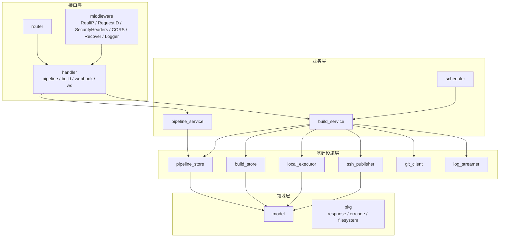
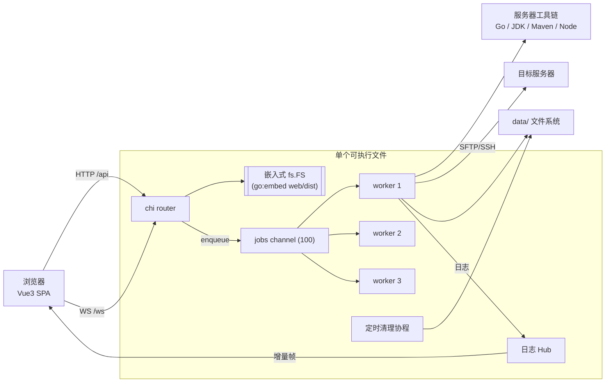
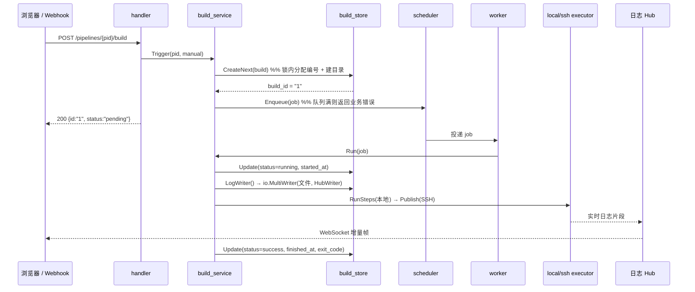
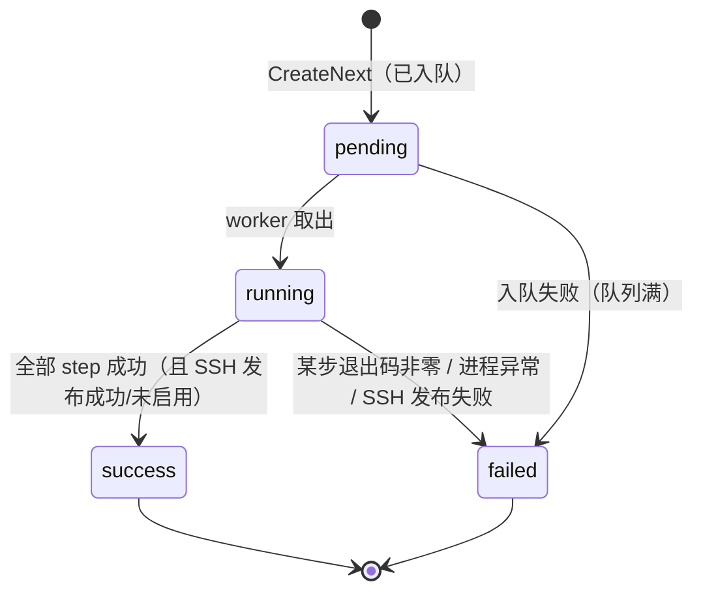
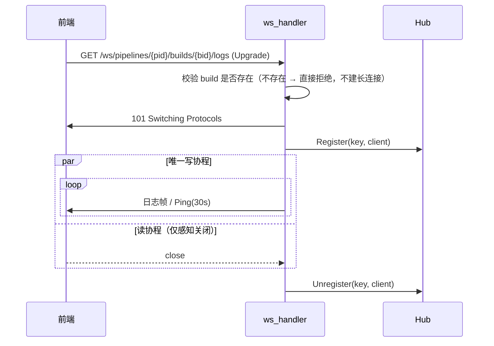
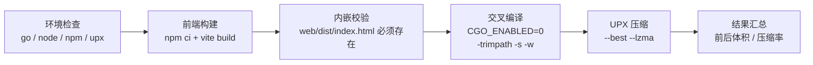

# 设计文档 · 轻量 CI/CD 平台

> 配套文档：[README.md](./README.md)（安装、构建、API）。
> 本文说明**为什么这么设计**，以及各子系统的关键机制与权衡。

---

## 1. 文档目的与范围

本文覆盖以下子系统的设计决策：

- 分层架构与依赖方向约束
- 文件系统存储（替代数据库）的正确性保障
- 构建执行引擎（状态机、并发模型、本地步骤执行）
- 日志子系统（双写、广播、背压、WebSocket 生命周期）
- SSH 发布子系统
- 前端架构（状态、轮询、重连）
- 前端内嵌与单文件交付
- 构建与发布流水线

不在范围内：权限体系、多节点 agent、DAG 并行、定时触发、插件系统（见第 12 节非目标）。

---

## 2. 设计目标与约束

| 类别 | 内容 |
|---|---|
| 核心目标 | 还原 Jenkins 最核心的用户心智，而非复刻其插件生态与 Groovy 能力 |
| 硬性约束 1 | **禁止引入任何数据库**（SQLite / MySQL / PostgreSQL 均不可），存储只走文件系统 |
| 硬性约束 2 | 构建直接在服务器本地执行，语言版本由已安装工具与「全局工具配置」决定，**代码中禁止出现 `switch language` 分支** |
| 硬性约束 3 | 依赖单向：`handler → service → store / executor → model`，禁止反向 import |
| 硬性约束 4 | SSH 交互必须全部收敛在 `ssh_publisher.go`，service 层禁止拼 SSH 命令 |
| 硬性约束 5 | 发布形态为**单文件**：前端资源内嵌，部署只需一个可执行文件 |
| 优先原则 | 优先「可运行」而非「功能多」：宁可少一个边缘功能，不可留断裂链路 |

---

## 3. 总体架构

### 3.1 分层与依赖方向



**依赖方向铁律**（`service` 通过 interface 依赖下游，接口定义在消费方 `service` 包内）：

| 层 | 只允许做 | 明确禁止 |
|---|---|---|
| `handler` | 参数解析、调 service、统一响应 | 业务分支、直接操作文件系统 |
| `service` | 唯一业务编排（状态流转、调度入队、事务边界） | 直接读写文件、拼 shell/ssh 命令 |
| `store` | 只做文件读写并返回 model | 状态机判断、调用 executor |
| `executor` | 接收参数执行本地命令/SSH/Git，通过 `io.Writer` 流式输出 | 访问 store |
| `model` | 纯结构体与枚举常量 | 任何 IO |
| `main` | 只做装配与生命周期 | handler/service 内做全局初始化 |

**收益**：`executor` 不依赖 `store`、`service` 只依赖抽象，因此把本地执行器换成远程 agent、或把存储换成对象存储，都只影响单层。

### 3.2 运行时组件图



### 3.3 一次构建请求的流转



---

## 4. 技术选型与理由

| 维度 | 选择 | 理由 |
|---|---|---|
| 后端语言 | Go 1.24 | 单二进制交付、`io.Writer` 流式管道天然适合日志转发、并发模型简洁 |
| HTTP 框架 | chi v5 | 标准库 `net/http` 兼容、路由树轻量、不引入额外抽象 |
| 存储 | 文件系统 | 硬性约束；且 JSON + 文本对人类可读、可 `git` 化、零运维 |
| 本地执行 | `os/exec` | 每个步骤独立进程，精确拿到退出码；stdout/stderr 直接流式写入日志 |
| SSH | `x/crypto/ssh` | 相比 CLI 封装：可直接读 stdout/stderr 管道，实现实时流式回显 |
| 文件传输 | `pkg/sftp` | 相比 `scp` CLI：可编程建目录、可精确控制路径映射 |
| WebSocket | `gorilla/websocket` | 成熟稳定，社区验证充分 |
| Git | `go-git` | 免安装 git 依赖，纯 Go 实现便于交叉编译 |
| 前端 | Vue3 + TS + Vite | 组合式 API 与 TS 类型能一一对齐后端 json tag |
| 前端交付 | `go:embed` | 硬性约束 5：单文件交付，消除「静态资源找不到」整类故障 |

---

## 5. 存储子系统设计

### 5.1 布局

采用 **「目录名即 ID」** 的设计，对齐 `JENKINS_HOME/jobs/{jobname}/builds/{id}/`：

```
data/jobs/{pipeline_id}/
├── config.json
└── builds/{build_id}/
    ├── build.json
    ├── log.txt
    ├── artifacts.json          # 产物清单（路径 / 大小 / SHA-256）
    └── artifacts/              # 每次构建独立保留的编译产物
```

**数据目录可迁移**：数据根目录默认 `./data`，可由引导配置 `ci-platform.json`（`-config` / `CI_CONFIG_FILE`）记录，
也可用 `-data-home` / `CI_DATA_HOME` 覆盖（优先级更高）。系统配置页可修改该目录并把
`jobs/`、`credentials/`、`settings.json` 复制到新位置，重启后生效；`workspace/` 为临时产物不迁移。

**为什么不用索引文件**：索引会引入「索引与实体不一致」的整类问题，需要修复工具与校验逻辑。
直接遍历目录（Pipeline 数量级为百、Build 数量级为千）开销可接受，换来的是**任何时刻只删目录即可自洽**。

### 5.2 数据结构

`config.json`（`model.Pipeline`）与 `build.json`（`model.Build`）即领域对象的直接序列化，
前端 `web/src/types/*.ts` 与之**逐字段对齐**（同一套 json tag），因此不存在 DTO 映射层。

### 5.3 原子写入

`pkg.WriteFileAtomic` 的步骤：

```
写入 <dir>/.tmp-* → f.Sync() → f.Close() → os.Rename(tmp, target)
```

- 同目录临时文件保证 `rename` 是同一文件系统内的原子操作。
- `Sync()` 保证数据落盘后再改名，避免掉电后出现「文件名正确但内容为空」。
- 读方永远只会看到旧版本或新版本，**不会读到半截 JSON**。
- Windows 上 `os.Rename` 使用 `MOVEFILE_REPLACE_EXISTING`，可覆盖已存在目标。

### 5.4 构建编号分配与并发

天真实现「`NextBuildID()` 返回 max+1」再 `Create()` 存在竞态：两个并发触发会拿到同一编号，
而编号即目录名，后写者会覆盖先写者。

因此 `BuildStore` 提供 **`CreateNext`**，在**同一把锁内**完成「扫描最大编号 → +1 → 建目录 → 写 build.json」：

```go
s.mu.Lock()
defer s.mu.Unlock()
id, _ := s.nextBuildIDLocked(pipelineID)   // 扫描 builds/ 取最大数字 +1
b.ID = id
pkg.EnsureDir(s.buildDir(...))
pkg.WriteJSONAtomic(..., b)
```

由于结果对外表现为「编号连续、单调递增、不重号」，语义与 Jenkins 的 `#1`、`#2` 一致。

### 5.5 一致性边界与故障恢复

| 场景 | 表现 | 恢复方式 |
|---|---|---|
| 进程在构建途中被杀 | `build.json` 停留在 `running` | 下次启动时 `BuildService.Recover` 将残留的 pending/running 标记为 failed |
| `config.json` 损坏（人工改动等） | `List` 跳过该目录，其余任务可正常列出 | 单目录故障不影响整体可用性 |
| 目录中残留临时文件 `.tmp-*` | 不影响读取 | 可安全删除 |
| 任务被删除 | `Delete` 递归删整个 `data/jobs/{id}/` | 无残留 |

**路径安全**：所有对外的 `id` 进入 store 前都会经过 `sanitizeID`，拒绝空值、`/\:*?"<>|` 与 `..`，避免路径穿越逃出 `data/jobs`。

---

## 6. 构建执行引擎

### 6.1 状态机



### 6.2 执行时序（`build_service.executeStages`）

```
1. 准备工作区 data/workspace/{workspace_dir}/（目录名默认取任务名；默认复用；delete_workspace_before_build=true 时先清空）
2. git_url 非空 → 已有 .git 则 fetch + hard reset，否则浅克隆（Depth=1, SingleBranch）
3. 在服务器工作区串行执行 steps（退出码非零 → 立即返回该退出码）
   - 每个步骤通过 shell 启动独立进程，工作目录为任务 workspace
   - 全局环境变量 + 「全局工具配置」中的工具主目录注入 env，并把主目录/bin 前置到 PATH
4. 仅当 artifacts.enabled == true → 按 glob 归档产物到 build/artifacts/ 并写 artifacts.json
5. 仅当 ssh_publish.enabled == true → SSH 发布（上传 + 远程命令）
6. 归一退出码：步骤失败 = 该步退出码；归档/SSH 失败 = 1；成功 = 0
```

**退出码语义**：`exit_code` 只在「构建步骤失败」时反映真实退出码，归档/SSH 阶段失败统一记 `1`，
入队失败记 `-1`。这样使用者能区分「代码编译失败」与「发布失败」。

### 6.3 并发模型

```
jobs chan Job (容量 100)  +  N 个 worker goroutine（默认 3，CI_WORKERS 可调）
```

- 队列满时 `Enqueue` **立即返回业务错误**（`code=40900`），不阻塞调用方，也不无限堆积。
- worker 数量即「同时运行的构建数」上限，天然形成资源闸门，避免同时编译把服务器压垮。
- worker 在 `ctx.Done()` 时退出；停机流程为：信号 → HTTP `Shutdown` → `Scheduler.Drain`
  等待运行中的构建（默认最长 30s，`-shutdown-timeout` 可调）→ 取消 worker 上下文 → `Wait` 退出，
  未取出的排队任务保持 pending，由下次启动的 `Recover` 标记为中断。
- **同一任务的构建串行执行**（不同任务并行）：避免并发写同一工作区；繁忙任务不会占满全部 worker。

### 6.4 步骤执行：逐步执行而非拼接脚本

若把 `steps` 拼成单个 shell 脚本，则无法区分是哪一步失败，中间步骤的退出码也会丢失。
因此每一步单独启动 `exec.CommandContext`，工作目录固定为任务 workspace：

| 收益 | 说明 |
|---|---|
| 精确退出码 | `cmd.Wait()` 返回每步独立退出码 |
| 实时输出 | stdout/stderr 直接写入 `io.Writer`，日志与 WebSocket 同步可见 |
| 明确边界 | 失败时立即停止后续步骤并打印 `step %q failed with exit code %d` |
| 环境一致 | 每步继承同一份环境变量（全局变量 + 工具主目录 + PATH） |

构建被取消时 `CommandContext` 会终止当前子进程，无需额外的清理逻辑。

### 6.5 构建产物归档

- 每个 build 目录下独立保存 `artifacts/` 与 `artifacts.json`，**下次构建不会覆盖历史产物**，用于回滚。
- 配置在任务「构建后操作 → 归档构建产物」：`artifacts.enabled` + `artifacts.files`（相对工作区 glob）。
- 归档时机：**构建步骤成功之后、SSH 发布之前**。SSH 发布失败时产物仍已落盘，构建页可下载。
- 旧任务一次性迁移：从 `go build -o <file>` / `jar cf <file>` 推断输出并自动启用（marker `.artifact-config-v1`）；其余保持关闭。
- 至少匹配一个文件，否则构建失败并提示，避免“构建成功但没有任何可回滚产物”。
- **规模保护**：`Settings.ArtifactMaxTotalMB` / `ArtifactMaxFiles`（默认 4096MB / 10000 文件）
  在归档前与复制后双重校验，超限时归档目录被清理并使构建失败，不会写满磁盘。
- 不跟随符号链接；只复制普通文件，保留可执行位，并计算 SHA-256 写入清单。
- 产物随「丢弃旧的构建」策略一起删除（`DeleteBuild` 递归删除 build 目录）；想保留全部历史构建就把保留数量/天数设为 0。
- **一键重新发布**：`BuildService.Republish` 读取成功构建的 `artifacts/`（由 `ArtifactReader.Manifest` 校验），
  `SshPublisher.PublishArtifacts` 只上传不编译；要求任务/请求提供 `server_id`，远程目录为空或 `/` 直接拒绝。
- 读取侧只允许下载 `artifacts.json` 清单中的相对路径，拒绝 `../`、绝对路径与符号链接。

### 6.6 工作区生命周期

- 路径：`data/workspace/{workspace_dir}`，目录名默认取任务名（非法字符替换、重名追加 `-{id}`），重命名任务时同步移动；默认**不清空**，保留上次产物与依赖缓存。
- 仅当任务显式设置 `delete_workspace_before_build=true` 时构建前删除整个工作区（会重新 clone）。
- Git 更新：已有 `.git` 时只 fetch；远端无新提交且受跟踪文件干净则跳过 reset。
- go-git 的 checkout/reset 会删除未跟踪与 `.gitignore` 忽略的文件，因此更新前把它们临时移动到工作区外的备份目录，
  更新后再移回；这样 `node_modules` / `target` / `dist` / Go 产物等缓存不会被清掉。
- 清理协程跳过**正在执行或排队中**的任务工作区，避免误删。
- 「管理旧数据」页面只列出/删除**无对应任务**的孤儿工作区与孤儿任务目录，仍存在任务的工作区一律保留。
- 只要任务仍然存在，其工作区就不参与 TTL 清理；只清理已删除任务遗留的孤儿目录。
- 构建结束后由 scheduler `os.Chtimes` 刷新目录 mtime，作为清理计时基准。
- 孤儿目录按 `CI_CLEAN_INTERVAL_MINUTES` 周期扫描，删除 mtime 早于 `CI_WORKSPACE_TTL_MINUTES`（默认 1h）的目录。
- **为什么用 mtime 而不是「创建时间文件」**：少一个元数据文件，且构建期间的写入天然刷新 mtime；
  构建结束时显式 touch 一次，即可让「TTL 从构建结束算起」这一语义成立。

---

## 7. 日志子系统

### 7.1 双写管道

```go
out := io.MultiWriter(
    logFileWriter,                                  // → data/jobs/{pid}/builds/{bid}/log.txt
                                                    //   归档/SSH 日志也写入同一份文件
    executor.NewHubWriter(hub, "pid/bid"),          // → WebSocket 订阅者
)
```

同一份 `out` 被注入本地执行器、产物归档器与 SSH 发布器，因此**构建/归档/SSH 日志天然合并到同一份 `log.txt`、
同一个 WebSocket 流**，前端无需区分来源，也不需要多路复用逻辑。

### 7.2 Hub 设计

```go
type Hub struct {
    mu   sync.RWMutex
    subs map[string]map[Subscriber]struct{}   // key = pipeline_id/build_id
}
```

关键实现要点：

1. **`Subscriber` 是接口而非 `*websocket.Conn`** —— 避免 `executor` 反向依赖 `handler` 层（依赖铁律）。
2. **广播前拷贝订阅者快照，出锁后再投递** —— 锁内只做 map 读取，绝不在持锁期间做网络 IO，
   否则一个慢客户端会阻塞整个 Hub。
3. key 下订阅者清空时回收 map 条目，避免长期运行下 map 无限增长。

### 7.3 背压策略：宁可丢帧，不可阻塞构建

构建日志的生产速度不受控（一个 `mvn` 可能瞬间打出上万行）。若采用「写入阻塞直到客户端消费」的策略，
慢客户端会反压到命令输出读取循环，进而**拖慢甚至卡死构建**。

因此定为：每个连接一个带缓冲的 `send chan []byte`，投递时使用非阻塞 `select ... default`，
**缓冲满则直接丢弃该帧**。理由：

- 日志是**可补偿**的：前端在重连时通过 `GET .../log` 重新拉取全文，丢帧不会造成用户可见的数据缺失。
- 构建是**不可重来**的（可能已产生副作用），绝不能被观测端拖累。

### 7.4 WebSocket 连接生命周期



- **单写协程**：`gorilla/websocket` 不允许并发写，因此每个连接只由 `writePump` 一个 goroutine 写，
  其他来源只往 `send` channel 投递。
- **`Enqueue` 必须拷贝数据**：上游 `stdcopy.StdCopy` 会复用其读缓冲，
  若直接入队会在下次读取时被覆写，导致日志错乱。
- **`close` 幂等**：用 `sync.Once` 保护，读协程与写协程同时退出不会 panic。

### 7.5 中间件与 WebSocket 的兼容

`middleware.Logger` 用 `statusRecorder` 包裹 `ResponseWriter` 以记录状态码与字节数，
这层包装**必须透传 `http.Hijacker` 与 `http.Flusher`**，否则 `Upgrade` 会失败（握手返回非 101）。
这是本项目实际踩到并修复的问题。

### 7.6 前端的重连与补帧

`useBuildLog.ts` 的策略：

| 关注点 | 策略 |
|---|---|
| 首屏 | 先 `GET .../log` 拉全文，**再**建 WebSocket 接收增量 |
| 断线重连 | 指数退避 `1s → 2s → 4s → 8s → 16s`，最多 5 次 |
| 补帧 | 每次重连前重新拉全文日志，覆盖断线期间的空洞（简单且绝对正确） |
| 结束判定 | 构建已结束时**不建** WebSocket；由 `usePolling` 轮询状态，一旦终态则停轮询、关连接、补拉最终日志 |
| 卸载 | `onUnmounted` 关闭连接、停止轮询 |

**为什么用轮询判断「构建结束」而不是靠服务端推事件**：服务端结束构建与关闭连接是两个独立关注点，
引入「结束事件帧」会让协议多一种消息类型。轮询 2s 一次的代价可忽略，换来协议极简。

---

## 8. SSH 发布子系统

对齐 Jenkins **Publish Over SSH** 的核心行为：上传指定文件到远程目录，可选在远程执行命令。

**配置分层**：

- **全局 SSH 服务器**：`settings.SshServers`（`data/settings.json`），集中维护 host/port/user/认证/私钥/密码/
  `known_hosts_path`/默认远程目录；接口返回时密码清空并标记 `has_password`，与 auth/SMTP 密码一致。
- **任务级**：`ssh_publish.server_id` + `source_files` / `remove_prefix` / `exec_command` / 可选远程目录覆盖。
  构建时 `BuildService.resolveSshConfig` 合并为完整配置；旧版内联 host/username 配置继续兼容。

```
1. dial  → 密钥(读 private_key_path，支持 `~/`) 或 密码认证；配置 `known_hosts_path` 时用
   `knownhosts.New` 校验主机密钥，未知主机拒绝连接；未配置时回退 `InsecureIgnoreHostKey` 并输出 WARN
2. upload → glob 展开 source_files → 计算相对路径 → 剥离 remove_prefix → SFTP MkdirAll + Create
3. exec   → exec_command 非空则开 session，stdout/stderr 两个 goroutine 合流入 out
```

要点：

- **`enabled=false` 时 `Publish` 立即返回 `nil`**，不发起任何连接（硬性约束，已在单测中断言）。
- **路径映射**：`applyRemovePrefix` 对 `target/` 与 `target` 两种写法都做兼容，
  并保证剥离后为空时回退原路径（避免上传到基础目录根导致文件名丢失）。
- **目录过滤**：`matchFiles` 只保留普通文件，遇到匹配到目录时跳过，避免 `Create` 失败。
- **安全**：`known_hosts_path` 配置后可抵御中间人攻击；未配置时保持兼容并输出 WARN，
  生产环境建议在「系统配置 → SSH 服务器」中填写。

---

## 9. 前端架构

```
view ──uses──> composable ──uses──> api / store
component：props 进、emit 出（不调 api、不写 store）
```

| 层 | 职责 | 约束 |
|---|---|---|
| `views/*.vue` | 页面装配与交互编排 | 不直接调 api，必须经 composable |
| `composables/*.ts` | 取数、订阅、轮询、重连 | 可调 api、可写 store |
| `stores/*.ts` | 仅跨组件共享状态（Pinia setup store） | 不放组件局部状态 |
| `api/*.ts` | 请求封装与类型标注 | 无业务判断 |
| `components/*.vue` | 纯展示与交互 | props 进、emit 出 |
| `types/*.ts` | 与 Go json tag 逐字段对齐 | 禁止 `any` |

关键组件职责：

- `SshPublishConfig.vue`：折叠面板；`auth_type` 切换时切换「私钥路径 / 密码」字段；
  `source_files` 用 `el-select` 的 `allow-create` 实现 tag 式录入；密码字段 `show-password` 且留空表示沿用旧值。
- `StepEditor.vue`：步骤增删与上下移动，向父组件提交**不可变副本**（`emit update:modelValue` 新数组），
  避免直接改 props 引发状态来源混乱。
- `LogTerminal.vue`：`props.lines` 渲染，`watch(length)` 后 `nextTick` 滚底，可暂停自动滚动。

**敏感字段处理**：编辑页加载时把 `password` 置空提交，服务端 `mergeSensitive` 在为空时沿用旧值，
实现「保存后不回显、不提交即不修改」。私钥只传路径，文件内容永不经过浏览器。

---

## 10. 前端内嵌与单文件交付

### 10.1 为什么 `assets.go` 必须在项目根

Go 的 `//go:embed` 指令**只能嵌入当前包目录及其子目录**下的文件，路径中不允许出现 `..`。
前端产物位于 `web/dist`，因此承载 embed 指令的包必须与 `web/` 同级 —— 即项目根目录。

```go
// assets.go（package assets）
//go:embed all:web/dist
var embeddedWeb embed.FS
```

`all:` 前缀确保连以 `.` / `_` 开头的文件也一并纳入（默认会跳过）。

### 10.2 用 `fs.FS` 抹平「内嵌 / 磁盘」差异

```go
func Resolve(diskFallback string) (fs.FS, string) {
    if sub, err := Embedded(); err == nil { return sub, "embedded" }        // 1. 内嵌优先
    if hasIndex(diskFallback)            { return os.DirFS(diskFallback), "disk:" + diskFallback }  // 2. 磁盘回退
    return nil, "none"                                                      // 3. 都不可用
}
```

`router` 只接收 `fs.FS`，**完全不关心资源来源**，因此：

- 生产：单文件交付，启动日志显示 `web assets source: embedded`。
- 开发/调试：把 `web/dist` 换掉即可，无需重新编译后端（显示 `disk:./web/dist`）。
- 资源缺失：返回 503 + 明确的中文修复指引，而不是 404 空白页。

### 10.3 SPA 深链回退

```
请求路径 → 去掉前导 / → path.Clean → 拒绝 .. 与 "." → fs.Stat 存在？→ FileServer 直出
                                                        └─ 不存在 → 返回 index.html
```

`path.Clean` + 前缀校验承担了路径穿越防护（`fs.FS` 本身也会拒绝非法路径，属双重保险）。
因此 `/pipelines/123/builds/1` 这类 history 模式深链刷新不会 404。

### 10.4 交付形态收益

| 收益 | 说明 |
|---|---|
| 零静态资源部署 | 不再需要「Nginx 托管 dist」或「拷贝 web/dist 到目标机」 |
| 消除整类故障 | 版本错配（后端新、前端旧）、路径找不到、权限不可读 |
| 体积可控 | 内嵌使二进制 +约 1.4MB；经 UPX 压缩后总产物约 3.3MB |

---

## 11. 构建与发布流水线



设计要点：

1. **`web/dist` 存在性是编译硬前提**，因此脚本在交叉编译前**显式校验**，失败时给出修复命令，
   而不是让使用者面对一条晦涩的 embed 报错。
2. **`CGO_ENABLED=0`** 保证纯静态链接，Linux 产物不依赖目标机 glibc 版本。
3. **`-trimpath`** 去掉本地绝对路径，让构建可复现、不泄露构建机目录结构。
4. **`-s -w`** 去掉符号表与 DWARF 调试信息（体积可降至约 55%），再交由 UPX 二次压缩。
5. **UPX 缺失自动降级**：提示安装地址后继续构建未压缩产物，不阻断流水线。
6. **`GOTOOLCHAIN=local`**：避免 `go.mod` 的 go 指令触发在线工具链下载，保证离线可复现。

### 版本注入

```bash
-ldflags "-s -w \
  -X main.buildVersion=$(git describe --tags --always --dirty) \
  -X main.buildCommit=$(git rev-parse --short HEAD) \
  -X main.buildDate=$(date -u +%Y-%m-%dT%H:%M:%SZ)"
```

`cmd/server/main.go` 中三个变量默认值为 `dev/none/unknown`，因此 `go run` 无需注入也能启动。

### 实测数据

| 产物 | 压缩前 | 压缩后 | 压缩率 |
|---|---|---|---|
| `ci-platform-linux-amd64` | 11.54 MB | 3.32 MB | 71.2% |
| `ci-platform-windows-amd64.exe` | 12.01 MB | 3.40 MB | 71.7% |

---

## 12. 关键权衡记录

| 决策 | 选择 | 被放弃的方案 | 理由 |
|---|---|---|---|
| 存储 | 文件系统 | SQLite | 硬性约束；且 JSON 可读、可 diff、零运维 |
| 任务索引 | 遍历目录 | 维护 index.json | 消除索引与实体不一致的整类问题 |
| 日志落盘 | `io.MultiWriter` 双写 | 先写内存再批量刷盘 | 实时性优先，且实现极简、无中间态 |
| 慢客户端 | 丢帧 | 阻塞/长缓冲 | 观测端不得拖累构建（构建不可重来） |
| 结束通知 | 前端轮询状态 | 服务端推送结束帧 | 协议更简单，2s 轮询代价可忽略 |
| 步骤执行 | 逐步骤 `exec.CommandContext` | 拼一个 shell 脚本 | 需要精确退出码与步骤边界 |
| 前端托管 | `go:embed` + `fs.FS` | 纯磁盘目录 | 单文件交付；`fs.FS` 让两种来源代码统一 |
| 构建入口包位置 | 项目根 `assets.go` | 放进 `internal/` | `go:embed` 不能使用 `..`，必须与 `web/` 同级 |
| 依赖版本 | `go mod tidy` 维护 | 手工钉版 | 已移除 Docker SDK，依赖面显著缩小 |

---

## 13. 已知限制与演进方向

### 当前限制

| 限制 | 说明 |
|---|---|
| SSH host key 默认未校验 | 未配置 `known_hosts_path` 时使用 `InsecureIgnoreHostKey`（日志 WARN）；配置后校验 |
| 单机执行 | 无多节点 agent，构建与调度都在同一进程 |
| 步骤串行 | 无 DAG / 并行步骤 |
| 前端大包 | Element Plus 全量引入，主 bundle 约 1MB（gzip 350KB），未做按需引入 |
| 日志文件无轮转 | 超长日志会持续增长（受构建输出量约束） |

### 演进方向（按性价比排序）

1. **SSH 连接测试按钮** —— `known_hosts` 校验已支持，剩余为连接连通性检测。
2. **Element Plus 按需引入**（`unplugin-vue-components`）—— 主 bundle 可降到约 30%。
3. **日志按大小切割 + 保留最近 N 次构建** —— 控制磁盘占用。
4. **构建取消接口**（`POST .../builds/{bid}/cancel`）—— 配合 `ctx` 取消已具备基础。
5. **多节点 agent** —— 需要引入注册与心跳机制，是当前架构最大的一次扩展。

---

## 附：验证记录

| 验证项 | 方法 | 结果 |
|---|---|---|
| 分层与编译 | `go build ./...` / `go vet ./...` | ✅ |
| 存储正确性 | `go test ./internal/store/...`（CRUD、编号自增、日志追加、递归删除、路径穿越拒绝） | ✅ |
| 日志广播 | `go test ./internal/executor/...`（广播/注销/无订阅者/并发） | ✅ |
| SSH 路径处理 | 单测 `applyRemovePrefix` / `matchFiles` / `relativeTo` / `enabled=false` 空操作 | ✅ |
| 产物归档 | 单测逐次构建目录、glob、SHA-256、越界拒绝；e2e 构建 1/2 产物互不覆盖 + 下载/ZIP | ✅ |
| 端到端 | 真实 HTTP 创建任务 → 触发 → 状态流转 → 日志落盘 → 日志 API 一致 | ✅ |
| WebSocket | 真实握手返回 `101 Switching Protocols` | ✅ |
| **前端内嵌** | 移走 `web/dist` 且 `CI_WEB_DIR` 指向不存在目录，页面与 1MB JS bundle 仍正常返回 | ✅ |
| **UPX 产物可运行** | 压缩后的 Windows 产物实测启动并完整提供 Web 界面 | ✅ |
| 交叉编译格式 | 文件头校验：Linux `ELF`(`7f454c46`) / Windows `MZ`(`4d5a9000`) | ✅ |
| 本地构建 | Go 编译可执行文件、javac + jar、npm 构建（Maven 使用同一执行路径） | ✅ |
